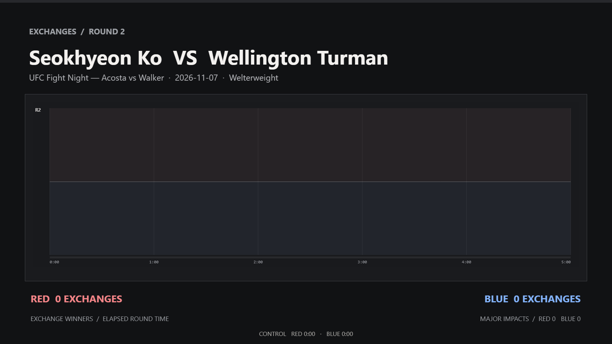

UFC Vegas 124 takes place November 7 in Las Vegas. Follow the results below as the card unfolds. I'll add my scoring and brief fight notes throughout the night.

## Main card

- Waldo Cortes-Acosta vs. Johnny Walker — *Pending*
- Tatiana Suarez vs. Virna Jandiroba — *Pending*
- Davey Grant vs. Elijah Smith — *Pending*
- Billy Elekana vs. Lucas Fernando — *Pending*
- Mantas Kondratavičius vs. Andre Petroski — *Pending*

## Prelims

- Karine Silva vs. Gabriella Fernandes — *Pending*
- Jose Delano vs. Murtazali Magomedov — *Pending*
- Austin Bashi vs. Carlos Calderon — *Pending*
- Keiichiro Nakamura vs. Ollie Schmid — *Pending*
- Mitch Raposo vs. Marcos Degli — *Pending*
- Gabriel Lorenco vs. Thomas Petersen — *Pending*
- Priscila Cachoeira vs. Nina Milošević — *Pending*
### Seokhyeon Ko vs. Wellington Turman — *Pending*

Round 1: Both are exchanging shots but it comes in on or two strikes each. Both throwing heavy and it is quite even though I do have Ko landing the better of the exchanges marginally. Ko with two takes downs and control time, some shots landed on the ground. 10-9 Ko.

Round 2: More of the same though Ko was able to land more effective strikes on the feet overall. Turman also landed his best strike of the fight and followed with spinning back fist. Still, Ko takes the round with effective striking and grappling. Turman looks exhausted. 20-18 Ko

<figure class="article-inline-image article-inline-image--break article-inline-image--center" data-writer-media-id="media-ba1ef202" data-media-flow="break" data-media-align="center" data-media-width="100" style="--media-width:100%;">
  
</figure>

---

### Jonny Parsons vs. José Souza — José Souza wins VIA knockout in round 1 (right uppercut, left hook)
Round 1: Parsons best work of the fight was slipping the jab and landing leg kicks. He had trouble with the range because Souza is massive. He threw a lot of head kicks that missed the mark. Souza best work came from his jab and knees. He had Parsons worried about the kicks, too. Once Parsons committed to his strikes though it was lights out. 

<figure class="article-inline-video article-inline-video--break article-inline-video--center" data-writer-media-id="media-270ae800" data-media-flow="break" data-media-align="center" data-media-width="100" style="--media-width:100%;">
  

    <video loop muted playsinline preload="none" src="https://github.com/MatlockFT/Matlock/releases/download/writer-media-2026-11/ufc-vegas-124-live-results-scoring-video-20261107-161250-340.mp4" aria-label="Article video"></video>
  

</figure>

<figure class="article-inline-image article-inline-image--break article-inline-image--center" data-writer-media-id="media-dcb94f6e" data-media-flow="break" data-media-align="center" data-media-width="100" style="--media-width:100%;">
  
</figure>

---

[Full-card breakdown and predictions](/2026/11/05/ufc-vegas-124-cortes-acosta-vs-walker.html)
