UFC Vegas 124 takes place November 7 in Las Vegas. Follow the results below as the card unfolds. I'll add my scoring and brief fight notes throughout the night.

## Main card

### Waldo Cortes-Acosta vs. Johnny Walker — *Pending*

Round 1: Insane first round with Walker destroying Acosta's lead leg and landing some good strikes. Great movement. But he did get dropped. 10-9 Cortes-Acosta

<figure class="article-inline-video article-inline-video--break article-inline-video--center" data-writer-media-id="media-165a0aeb" data-media-flow="break" data-media-align="center" data-media-width="100" style="--media-width:100%;">
  

    <video loop muted playsinline preload="none" src="https://github.com/MatlockFT/Matlock/releases/download/writer-media-2026-11/ufc-vegas-124-live-results-scoring-video-20261107-220233-668.mp4" aria-label="Article video"></video>
  

</figure>

Round 2: Walker, still targeting leg but he is slower, more tired. Story of this round is Waldo staying aggressive and getting a takedown. 20-18 Cortes-Acosta

<figure class="article-inline-video article-inline-video--break article-inline-video--center" data-writer-media-id="media-c0786c9f" data-media-flow="break" data-media-align="center" data-media-width="100" style="--media-width:100%;">
  

    <video loop muted playsinline preload="none" src="https://github.com/MatlockFT/Matlock/releases/download/writer-media-2026-11/ufc-vegas-124-live-results-scoring-video-20261107-220049-465.mp4" aria-label="Article video"></video>
  

</figure>

Round 3: Both guys are tired. Waldo throwing heavy, Walker throwing kicks. Acosta ties up, they're tired. Herzog separates, Waldo presses forward and Johnny just landed a spinning back elbow, could be a forearm or fist, and Waldo stumbles back! Johnny rushes FORWARD WITH A RIGHT HAND AND ACOSTA GOES DOWN, JOHNNY WITH GROUND AND POUND! HERZOG STOPS IT! 2:27 of the third round TKO victory for Johnny Walker!

<figure class="article-inline-video article-inline-video--break article-inline-video--center" data-writer-media-id="media-9e1dcf15" data-media-flow="break" data-media-align="center" data-media-width="100" style="--media-width:100%;">
  

    <video loop muted playsinline preload="none" src="https://github.com/MatlockFT/Matlock/releases/download/writer-media-2026-11/ufc-vegas-124-live-results-scoring-video-20261107-220611-602.mp4" aria-label="Article video"></video>
  

</figure>

---

### Tatiana Suarez vs. Virna Jandiroba — *Tatiana Suarez wins via unanimous decision (30-27 x2, 29-28)*

Round 1: On the feet fairly even with Jandiroba landing kicks and trying for straight punches and Suarez jabbing to the body. A lot of control time for Suarez. 10-9 Suarez

<figure class="article-inline-image article-inline-image--break article-inline-image--center" data-writer-media-id="media-155ccb4b" data-media-flow="break" data-media-align="center" data-media-width="100" style="--media-width:100%;">
  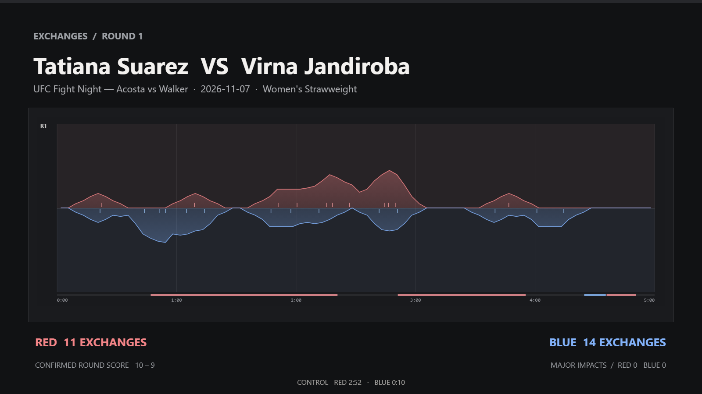
</figure>

<section class="article-html-visual">
<figure class="article-inline-video article-inline-video--break article-inline-video--center" data-writer-media-id="media-3e1e01f2" data-media-flow="break" data-media-align="center" data-media-width="100" style="--media-width:100%;">
  

    <video loop muted playsinline preload="none" src="https://github.com/MatlockFT/Matlock/releases/download/writer-media-2026-11/ufc-vegas-124-live-results-scoring-video-20261107-212424-274.mp4" aria-label="Article video"></video>
  

</figure>
</section>
Round 2: Very even on the feet again, Suarez a bit more aggression I suppose and she gets the takedown. She's working the body but the punches are virtually ineffective. Virna gets a kneebar at the very end but can't secure it. Suarez 20-18

<figure class="article-inline-image article-inline-video--break article-inline-video--center article-inline-image--break article-inline-image--center" data-writer-media-id="media-3e1e01f2" data-media-flow="break" data-media-align="center" data-media-width="100" style="--media-width:100%;">
  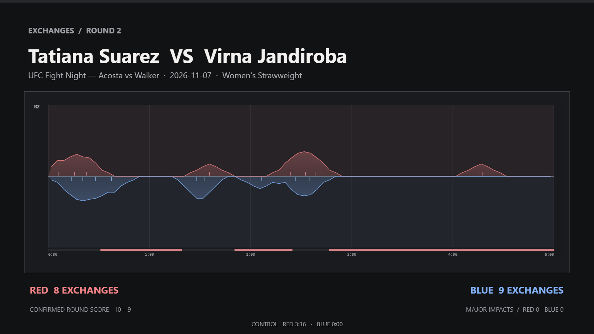
</figure>

Round 3: Same shit. All control from Suarez. 30-27 Suarez

<figure class="article-inline-image article-inline-image--break article-inline-image--center" data-writer-media-id="media-15d9b5b4" data-media-flow="break" data-media-align="center" data-media-width="100" style="--media-width:100%;">
  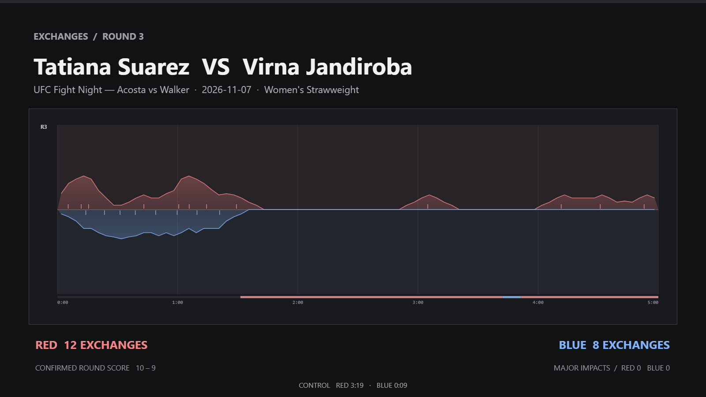
</figure>

---

### Davey Grant vs. Elijah Smith — *Elijah smith wins via knockout in round 1*

Round 1: Both meet in center and exchange kicks. They both trade punches, clip each other but Davey took the worse shot. Elijah all over him and knocks him down and out. Davey's eyes are wide open, he's seeing visions of the Land of Wind and Ghosts. 

<figure class="article-inline-video article-inline-video--break article-inline-video--center article-inline-image--break article-inline-image--center" data-writer-media-id="media-f37ee4e0" data-media-flow="break" data-media-align="center" data-media-width="100" style="--media-width:100%;">
  

    <video loop muted playsinline preload="none" src="https://github.com/MatlockFT/Matlock/releases/download/writer-media-2026-11/ufc-vegas-124-live-results-scoring-video-20261107-205514-422.mp4" aria-label="Article video"></video>
  

</figure>

There is a lot to like about Alijah Smith who continues to have great performances, good on the microphone, a class act, and calls his shot. 

---

### Billy Elekana vs. Lucas Fernando — *Lucas Fernando wins via unanimous decision (29-28 x3)*

Round 1: Not much from Billy. Lucas all offense and heavy, heavy strikes. A lot of knees to the body. 
10-9 Fernando

<figure class="article-inline-image article-inline-image--break article-inline-image--center article-inline-video--break article-inline-video--center" data-writer-media-id="media-dc145e53" data-media-flow="break" data-media-align="center" data-media-width="100" style="--media-width:100%;">
  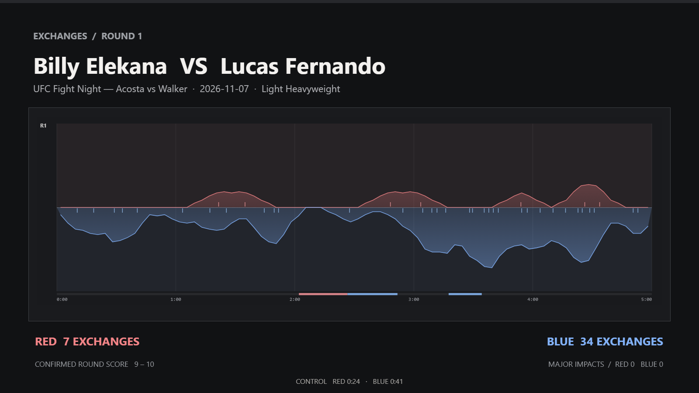
</figure>

Round 2: Fernando's pace slowed considerably. Still landing heavy but much of this fight took place in the clinch against the cage. 20-18 Fernando

<figure class="article-inline-image article-inline-image--break article-inline-image--center" data-writer-media-id="media-bd9e6af5" data-media-flow="break" data-media-align="center" data-media-width="100" style="--media-width:100%;">
  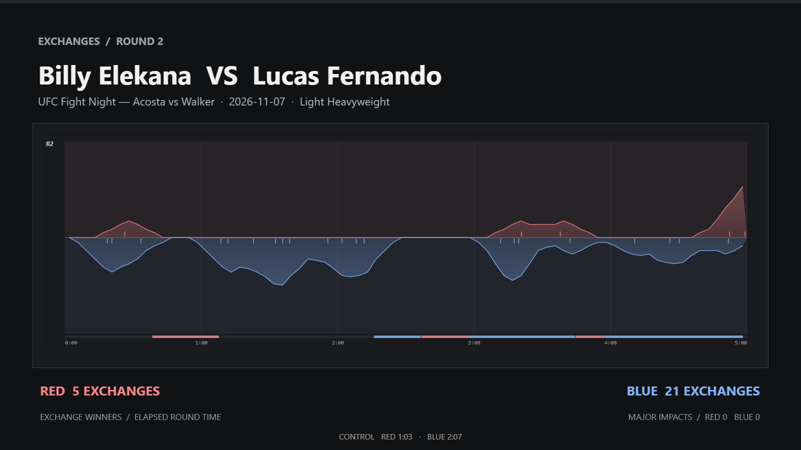
</figure>

Round 3: Fernando lands a couple good shots but then gets taken down. Billy lays on him up until the very end when he starts getting some ground and pound off. This fight started pretty good and then ended up a complete snoozefest. Horrible fight and not a good look for either fighter.

<figure class="article-inline-image article-inline-image--break article-inline-image--center" data-writer-media-id="media-d6722481" data-media-flow="break" data-media-align="center" data-media-width="100" style="--media-width:100%;">
  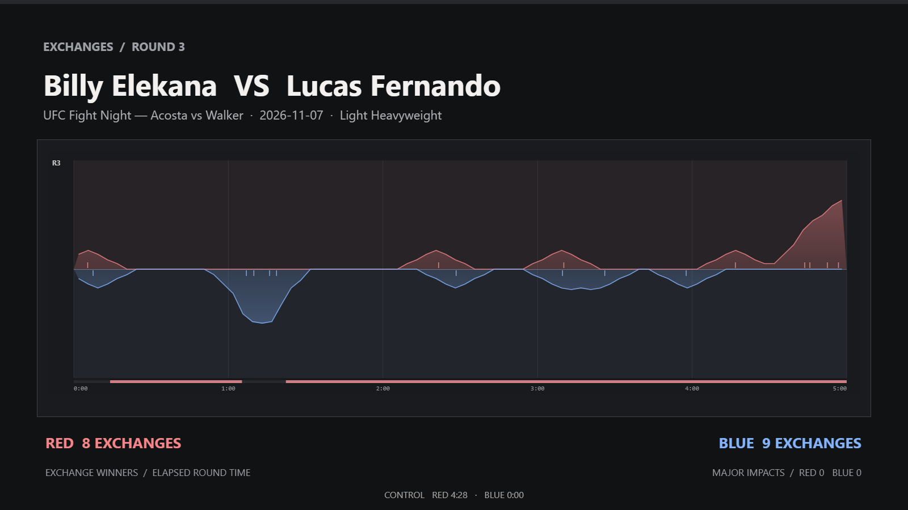
</figure>

---

### Priscila Cachoeira vs. Nina Milošević — *Nina Milošević wins via round 2 TKO (ground and pound)*
Round 1: Nina does a McGregor jumping switch kick, dives for a takedown, pitter patter punches Priscila for the entire round. Priscila did nothing but survive. 10-8 Nina

<figure class="article-inline-image article-inline-image--break article-inline-image--center" data-writer-media-id="media-0e7ff7fc" data-media-flow="break" data-media-align="center" data-media-width="100" style="--media-width:100%;">
  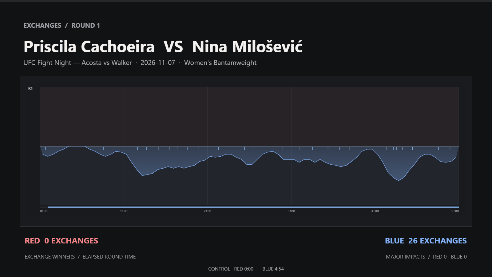
</figure>

Round 2: Now they're exchanging. I'm reminded again why I'm not really high on Milsevic who is doing well but there is something about her game that just doesn't quite click. After several exchanges with Priscila, she takes her down, beats her up in mount, ref Herzog steps in to stop it.

<figure class="article-inline-video article-inline-video--break article-inline-video--center article-inline-image--break article-inline-image--center" data-writer-media-id="media-293c59f4" data-media-flow="break" data-media-align="center" data-media-width="100" style="--media-width:100%;">
  

    <video loop muted playsinline preload="none" src="https://github.com/MatlockFT/Matlock/releases/download/writer-media-2026-11/ufc-vegas-124-live-results-scoring-video-20261107-200528-502.mp4" aria-label="Article video"></video>
  

</figure>

---

### Mitch Raposo vs. Marcos Degli — *Mitch Raposo wins via unanimous decision (29-28 x3)*

Round 1: A close round but Raposo simply did more and landed more. Degli is obviously fast and landed some damaging, powerful strikes but it just wasn't enough on my card. 10-9 Raposo who worked the body quite nicely.

<figure class="article-inline-image article-inline-image--break article-inline-image--center article-inline-video--break article-inline-video--center" data-writer-media-id="media-af3b61bc" data-media-flow="break" data-media-align="center" data-media-width="100" style="--media-width:100%;">
  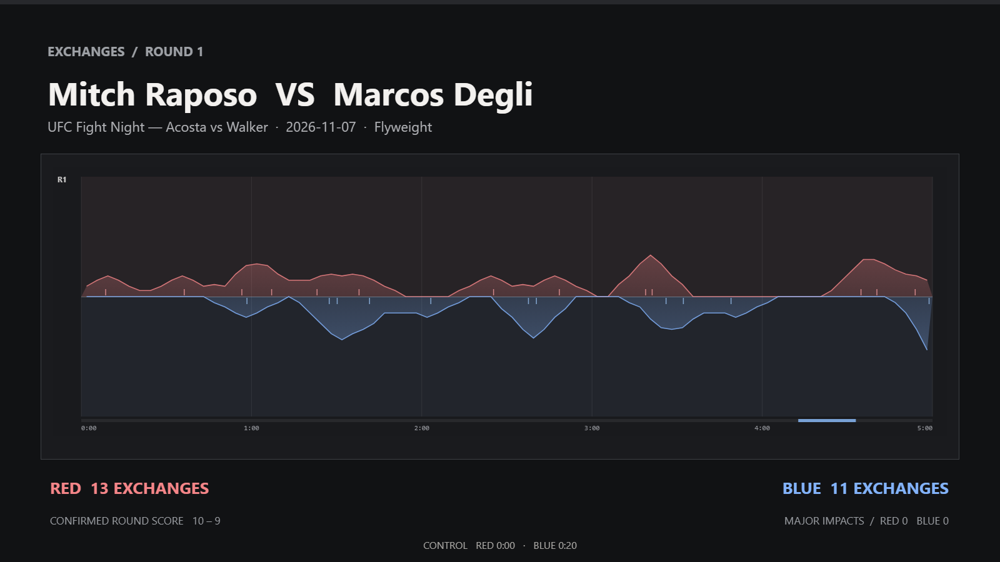
</figure>

Round 2: Again, I think an excellent round from Raposo who really is putting in work to the body and doing well to be hard to read, landing in more volume and shots. Lets not forget Raposo also cut Degli in round 1 and its turned into a mouse in round 2. 20-18 Raposo

<figure class="article-inline-image article-inline-image--break article-inline-image--center" data-writer-media-id="media-e1f813bb" data-media-flow="break" data-media-align="center" data-media-width="100" style="--media-width:100%;">
  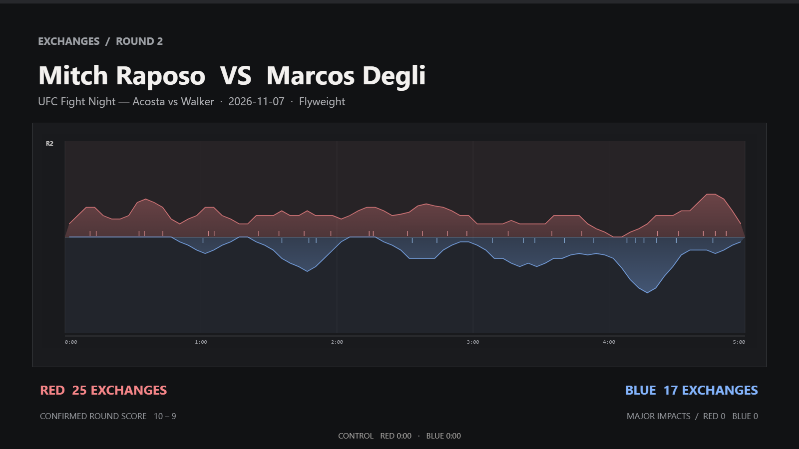
</figure>

Round 3: A much better round for Degli as he started that round with a high pace and volume, landing well. An unfortunate clash of heads opens up Raposo (someone noted it was an elbow but I haven't rewatched) but still, even by the end of this round, Raposo started putting it together. I have 30-27 Raposo
Judges got it 29-28 Mitch Raposo

<figure class="article-inline-image article-inline-image--break article-inline-image--center" data-writer-media-id="media-18dc2d3f" data-media-flow="break" data-media-align="center" data-media-width="100" style="--media-width:100%;">
  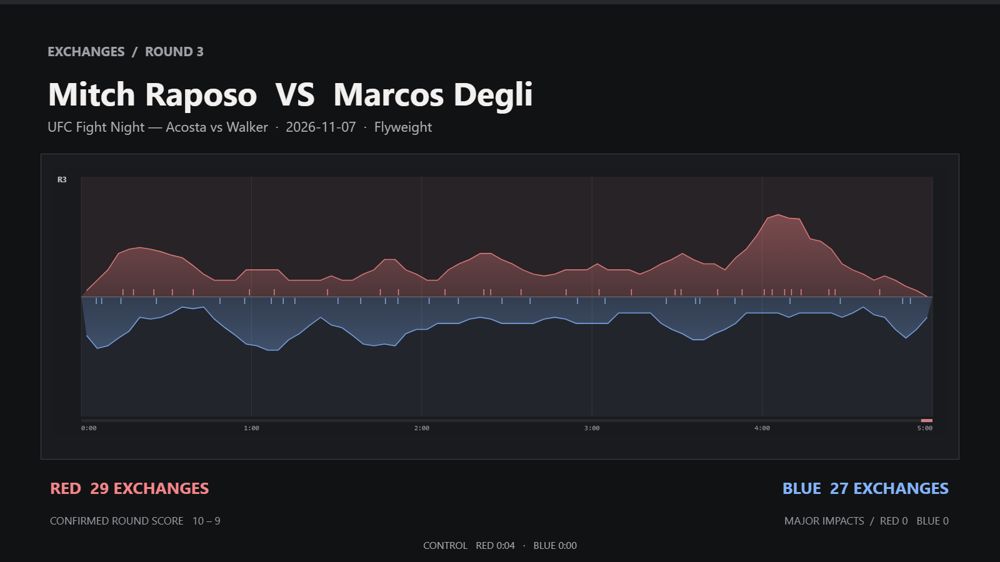
</figure>

---

## Prelims

### Keiichiro Nakamura vs. Ollie Schmid — *Ollie Schmid wins via unanimous decisions (29-28 x3)*

Round 1: All contest at range almost throwing all kicks. Schmid at the more highlightable shots, if you will but Nakamura landed more volume. 10-9 Nakamura but I could see it 10-9 the other way.

<figure class="article-inline-image article-inline-image--break article-inline-image--center" data-writer-media-id="media-1ad49b82" data-media-flow="break" data-media-align="center" data-media-width="100" style="--media-width:100%;">
  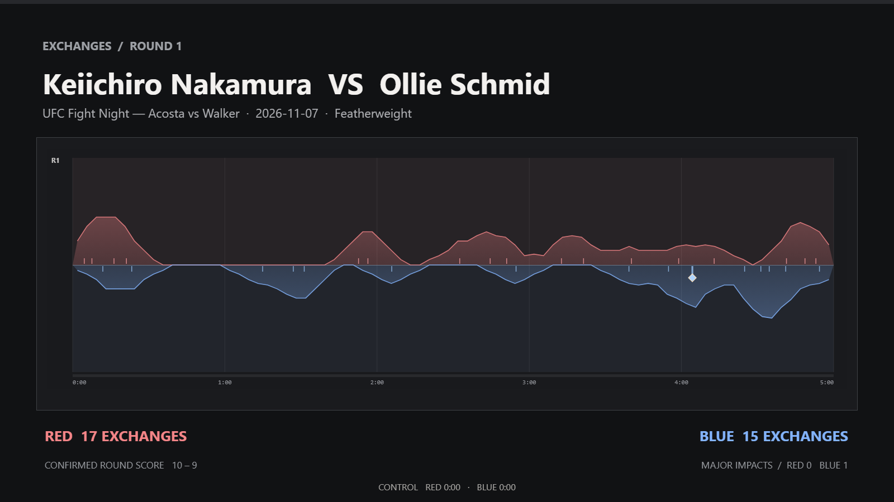
</figure>

Round 2. More of the same but Nakamura kicked Schmid right in the cock. Schmid had a much better round, more volume, more damaging strikes 19-19 Schmid. 

<figure class="article-inline-image article-inline-image--break article-inline-image--center" data-writer-media-id="media-c55de481" data-media-flow="break" data-media-align="center" data-media-width="100" style="--media-width:100%;">
  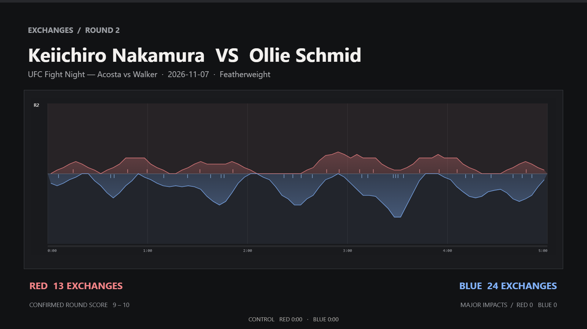
</figure>

<figure class="article-inline-video article-inline-video--break article-inline-video--center article-inline-image--break article-inline-image--center" data-writer-media-id="media-4361c5a2" data-media-flow="break" data-media-align="center" data-media-width="100" style="--media-width:100%;">
  

    <video loop muted playsinline preload="none" src="https://github.com/MatlockFT/Matlock/releases/download/writer-media-2026-11/ufc-vegas-124-live-results-scoring-video-20261107-190349-409.mp4" aria-label="Article video"></video>
  

</figure>

Round 3: Nakamura comes out fast and strong. Landing at a high clip and doing damage. Now they are striking at range, a tempo that favors more Schmid. Schmid lands a low blow, ref stops it but then the ref corner says it wasn't a low blow, so action starts again right away. Nakamura pours it on and drops Schmid. Could be scored a 10-8 but for me 10-9. 29-28 Nakamura for me.

<figure class="article-inline-image article-inline-image--break article-inline-image--center article-inline-video--break article-inline-video--center" data-writer-media-id="media-835e4341" data-media-flow="break" data-media-align="center" data-media-width="100" style="--media-width:100%;">
  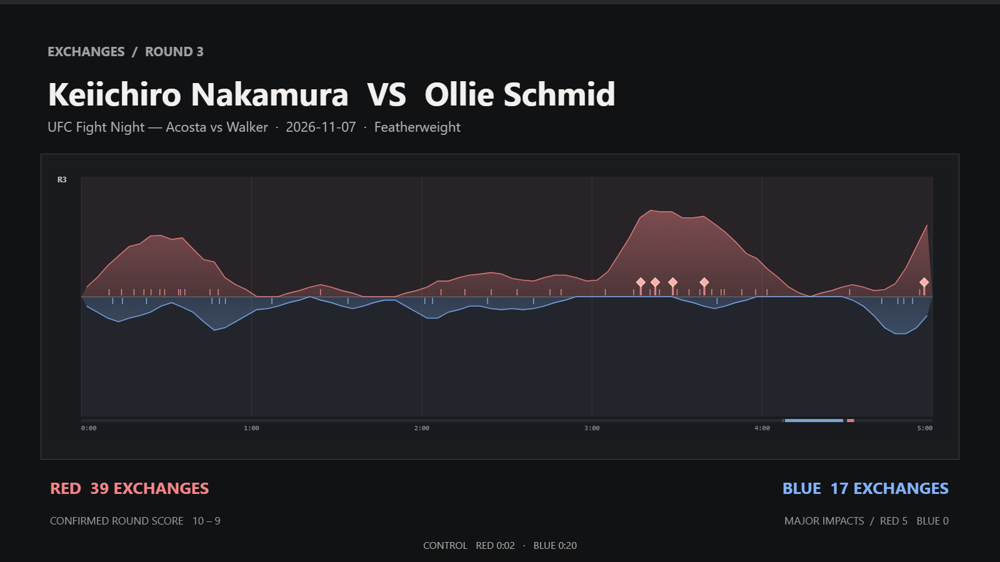
</figure>

Judges disagree and give Schmid 29-28 (x3)

### Gabriel Lorenco vs. Thomas Petersen — *Thomas Petersen via TKO in round 3 (Ground and pound)*

Round 1: Lorenco just went off, smashing Petersen but Petersen is so fucking tough this is insane. Aside from a takedown, one uppercut, and some control time - Petersen got crushed. 10-8 Lorenco

<figure class="article-inline-image article-inline-image--break article-inline-image--center" data-writer-media-id="media-0ef8a113" data-media-flow="break" data-media-align="center" data-media-width="100" style="--media-width:100%;">
  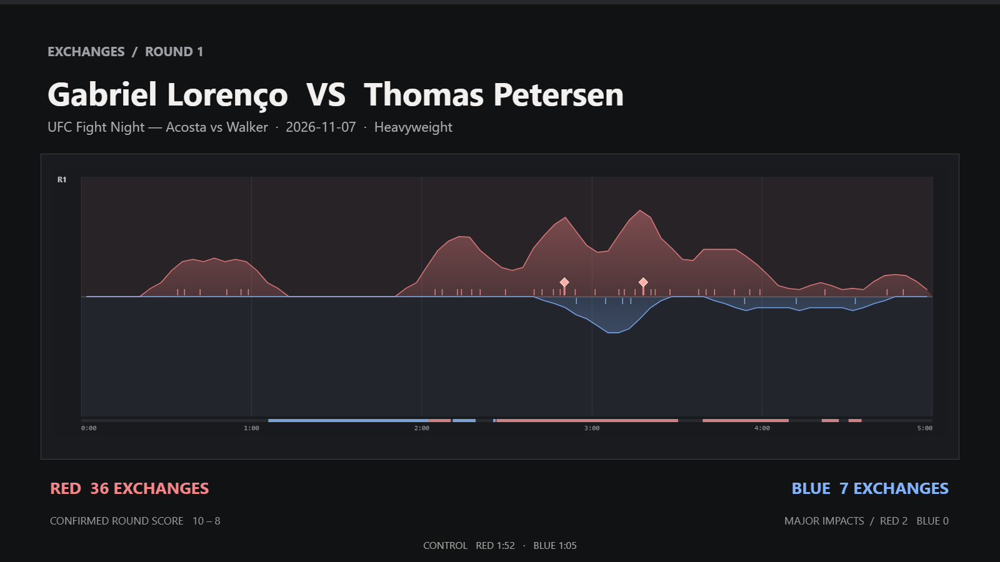
</figure>

Round 2: Lorenco is fucking exhausted and Petersen drops Lorenco. He secures top position but is unable to do much with it. Both gassed, Petersen barely getting the better of the exchanges on the feet. 19-18 Lorenco

<figure class="article-inline-image article-inline-image--break article-inline-image--center" data-writer-media-id="media-b8752d3e" data-media-flow="break" data-media-align="center" data-media-width="100" style="--media-width:100%;">
  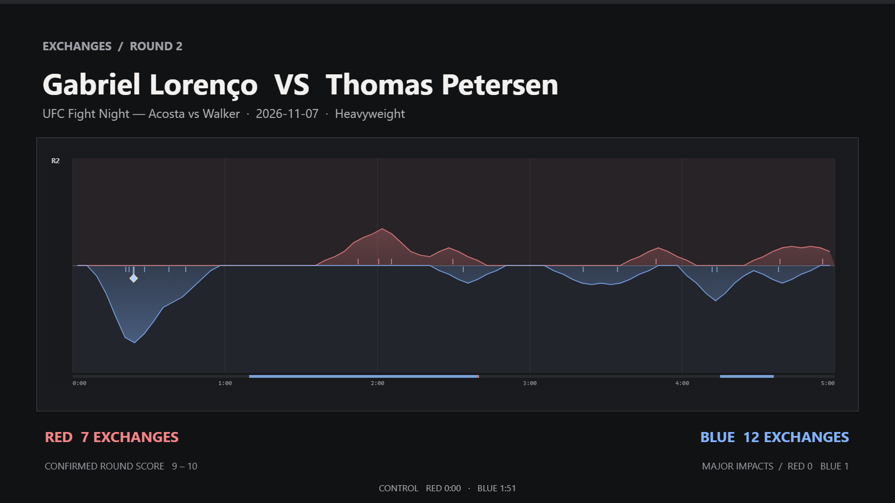
</figure>

Round 3: Petersen lands some shots, closes distance takes Lorenco down. He is maintaining position and chipping away but with not much time left on the clock Petersen starts hammering away! INCREDIBLE! THE REF STOPS! MINNESOTA TOUGH! PETERSEN GETS IT DONE IN ROUND 3! Had it not been stopped, Petersen would've fought to a draw. 

<figure class="article-inline-image article-inline-image--break article-inline-image--center" data-writer-media-id="media-da98c0ab" data-media-flow="break" data-media-align="center" data-media-width="100" style="--media-width:100%;">
  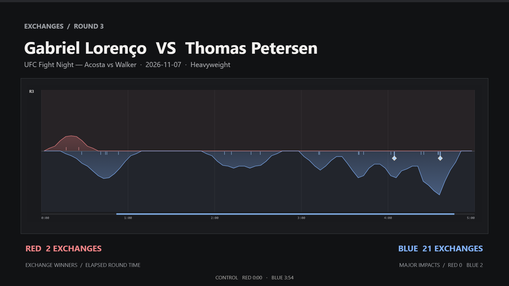
</figure>

---

### Karine Silva vs. Gabriella Fernandes — *Karine Silva wins via unanimous decision (29-28 x3)*
### 
Round 1: Tremendously slow round where they just held each other against the cage. silva landed more strikes against the cage with no separation. 10-9 Silva

<figure class="article-inline-image article-inline-image--break article-inline-image--center" data-writer-media-id="media-4af5aa98" data-media-flow="break" data-media-align="center" data-media-width="100" style="--media-width:100%;">
  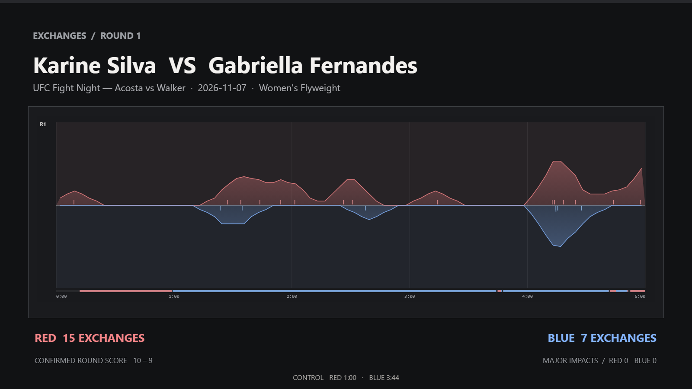
</figure>

Round 2: Now both are at range landing kicks and trying to strike so far out of range. This is an all time shit fight. Now they're back against the cage doing the same thing they did in round 1. Silva landing better shots off the cage. 20-18 Silva

<figure class="article-inline-image article-inline-image--break article-inline-image--center" data-writer-media-id="media-1a139bd7" data-media-flow="break" data-media-align="center" data-media-width="100" style="--media-width:100%;">
  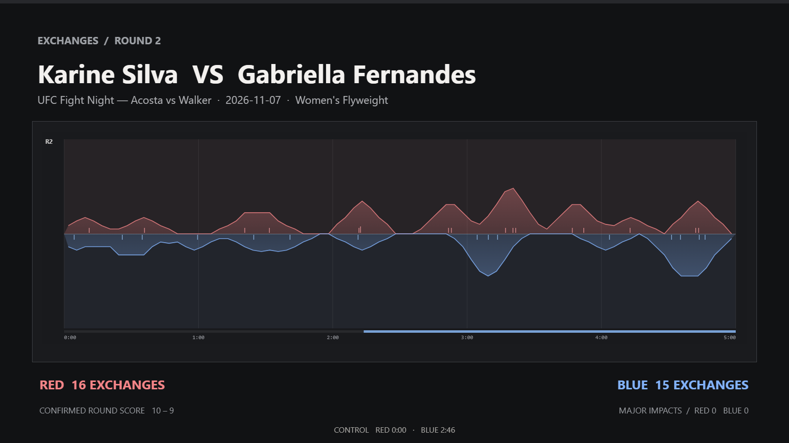
</figure>

Round 3: Their striking at range is horrible but Silva landed better shots. It's so weird that all of Silva's best strikes come when she is being pressed against the cage. 30-27 Silva

<figure class="article-inline-image article-inline-image--break article-inline-image--center" data-writer-media-id="media-fe87bd50" data-media-flow="break" data-media-align="center" data-media-width="100" style="--media-width:100%;">
  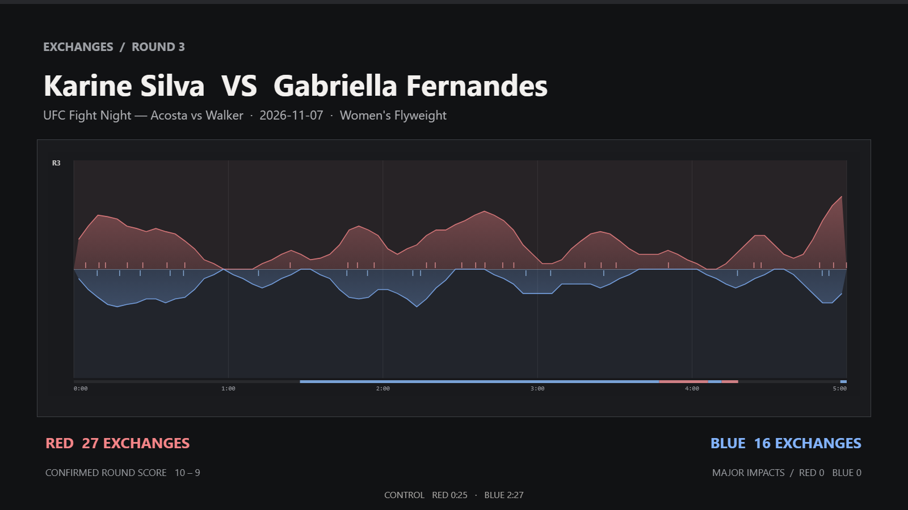
</figure>

An all time shit fight, easily forgettable. Silva screams at the bell when the fights over as if she just won via knockout and then cries when they call her name for the decision win. 

<figure class="article-inline-video article-inline-video--break article-inline-video--center article-inline-image--break article-inline-image--center" data-writer-media-id="media-5a606328" data-media-flow="break" data-media-align="center" data-media-width="100" style="--media-width:100%;">
  

    <video loop muted playsinline preload="none" src="https://github.com/MatlockFT/Matlock/releases/download/writer-media-2026-11/ufc-vegas-124-live-results-scoring-video-20261107-181103-789.mp4" aria-label="Article video"></video>
  

</figure>

---

### Jose Delano vs. Murtazali Magomedov — *Murtazali Magomedov wins via Unanimous Decision (29-28 x3)*

Round 1: Delano with better volume and striking on the feet. Magomedov with power, he capitalized on a slip. but 10-9 Delano.

<figure class="article-inline-image article-inline-image--break article-inline-image--center article-inline-video--break article-inline-video--center" data-writer-media-id="media-997e9896" data-media-flow="break" data-media-align="center" data-media-width="100" style="--media-width:100%;">
  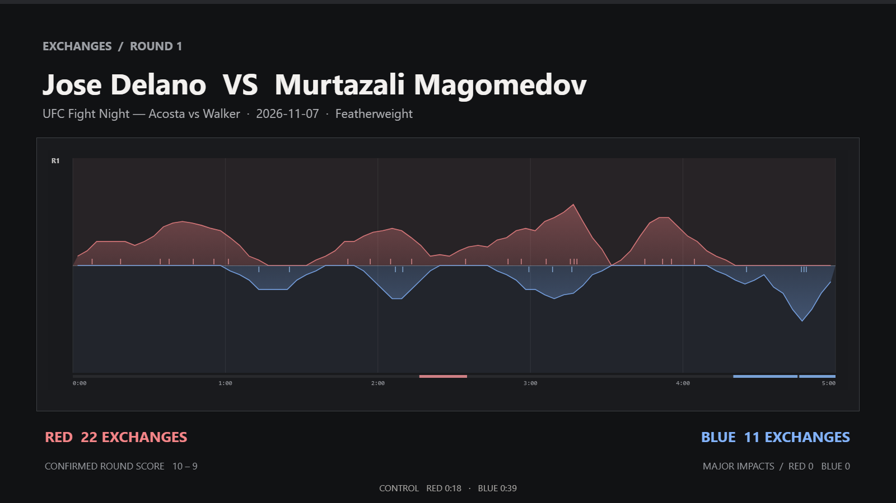
</figure>

Round 2: Pretty intense second round as we pick up where we left off with the high volume striking of Delano. Landing great shots but Magomedov was able to knock a lot of time off the clock with a takedown. He didn't do much on the ground and Delano made the most of a minute or so left. He ate a big head kick but I really think Delano did better in this second round to just take it back. 20-18 Delano

<figure class="article-inline-image article-inline-image--break article-inline-image--center" data-writer-media-id="media-fcae8754" data-media-flow="break" data-media-align="center" data-media-width="100" style="--media-width:100%;">
  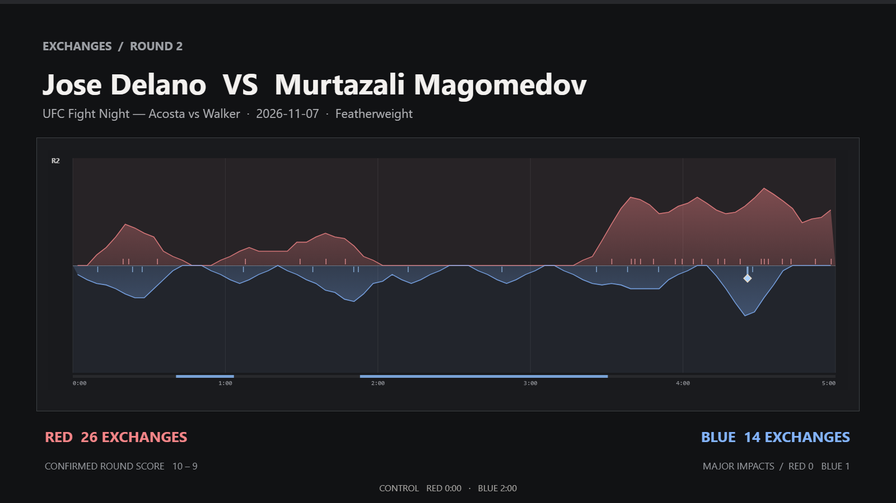
</figure>

<figure class="article-inline-video article-inline-video--break article-inline-video--center article-inline-image--break article-inline-image--center" data-writer-media-id="media-e820a549" data-media-flow="break" data-media-align="center" data-media-width="100" style="--media-width:100%;">
  

    <video loop muted playsinline preload="none" src="https://github.com/MatlockFT/Matlock/releases/download/writer-media-2026-11/ufc-vegas-124-live-results-scoring-video-20261107-174348-805.mp4" aria-label="Article video"></video>
  

</figure>

Round 3: Similar to the second round with Delano landing on the feet often and consistently. Magomedov gets a takedown but cannot at all produce anything offensive and Delano makes it back to the feet. The major difference maker of this round is Magomedov almost finished Delano at the very end of the round. So if you wanted to score it a 10-8 you could because had there been 10 more seconds or less on the clock, the fight would've been over. So it could be 28-28. I'm scoring it 29-28 for Delano.

<figure class="article-inline-image article-inline-image--break article-inline-image--center article-inline-video--break article-inline-video--center" data-writer-media-id="media-f644a1c6" data-media-flow="break" data-media-align="center" data-media-width="100" style="--media-width:100%;">
  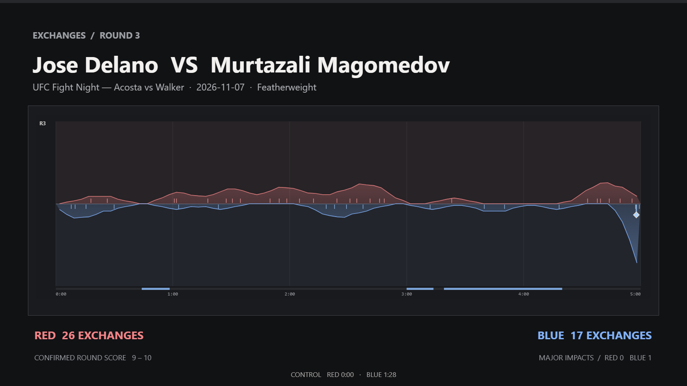
</figure>

---

### Austin Bashi vs. Carlos Calderon — *Austin Bashi via submission round 1 (Rear-naked choke)*

Round 1: Calderon looking very confident. Comes out to center, lands some shots, might've even hurt Bashi for a second but Bashi takes him down, takes his back, locks in the rear-naked choke. 

<figure class="article-inline-video article-inline-video--break article-inline-video--center article-inline-image--break article-inline-image--center" data-writer-media-id="media-26561759" data-media-flow="break" data-media-align="center" data-media-width="100" style="--media-width:100%;">
  

    <video loop muted playsinline preload="none" src="https://github.com/MatlockFT/Matlock/releases/download/writer-media-2026-11/ufc-vegas-124-live-results-scoring-video-20261107-170933-083.mp4" aria-label="Article video"></video>
  

</figure>

---

### Mantas Kondratavičius vs. Andre Petroski — *Andre Petroski wins via round 2 TKO (ground and pound)*
Round 1: Kondra comes out fast and heavy, both are swinging hard. Petroski trying to find success in the takedowns. Good work at end for Petroski and dynamic might change as Kondra threw a lot of heavy shots. Could be tired in the second. 10-9 Kondra.

<figure class="article-inline-image article-inline-image--break article-inline-image--center article-inline-video--break article-inline-video--center" data-writer-media-id="media-d7ff26b7" data-media-flow="break" data-media-align="center" data-media-width="100" style="--media-width:100%;">
  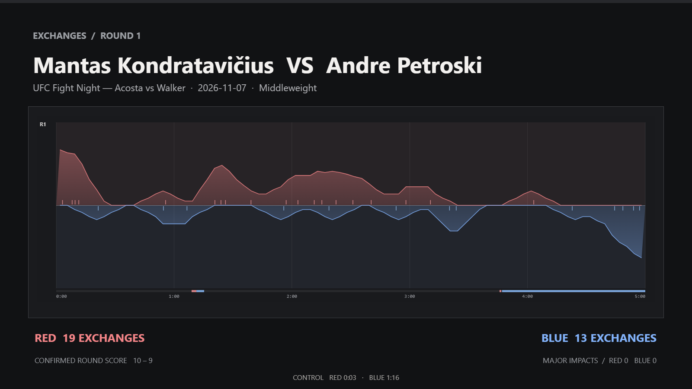
</figure>

Round 2: They both exchange heavy on the feet with Kondra landing cleaner better shots. Petroski takes it down. Kondra is looking fatigued and Petroski is wasting no time creating openings and landing shots. He does this for most of the round and pours on heavy near the end. Kondra isn't getting out of it and the ref stops the fight. 

<figure class="article-inline-video article-inline-video--break article-inline-video--center article-inline-image--break article-inline-image--center" data-writer-media-id="media-1006e118" data-media-flow="break" data-media-align="center" data-media-width="100" style="--media-width:100%;">
  

    <video loop muted playsinline preload="none" src="https://github.com/MatlockFT/Matlock/releases/download/writer-media-2026-11/ufc-vegas-124-live-results-scoring-video-20261107-165619-478.mp4" aria-label="Article video"></video>
  

</figure>

---

### Seokhyeon Ko vs. Wellington Turman — *Seokhyeon Wins via Unanimous Decision  (30-27 x3)*

Round 1: Both are exchanging shots but it comes in on or two strikes each. Both throwing heavy and it is quite even though I do have Ko landing the better of the exchanges marginally. Ko with two takes downs and control time, some shots landed on the ground. 10-9 Ko.

<figure class="article-inline-image article-inline-image--break article-inline-image--center article-inline-video--break article-inline-video--center" data-writer-media-id="media-73c3d8a0" data-media-flow="break" data-media-align="center" data-media-width="100" style="--media-width:100%;">
  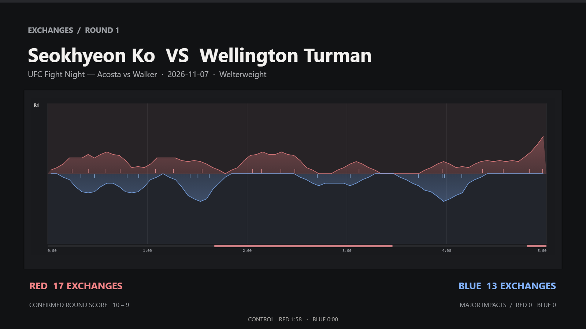
</figure>

Round 2: More of the same though Ko was able to land more effective strikes on the feet overall. Turman also landed his best strike of the fight and followed with spinning back fist. Still, Ko takes the round with effective striking and grappling. Turman looks exhausted. 20-18 Ko

<figure class="article-inline-image article-inline-image--break article-inline-image--center" data-writer-media-id="media-38f2e23a" data-media-flow="break" data-media-align="center" data-media-width="100" style="--media-width:100%;">
  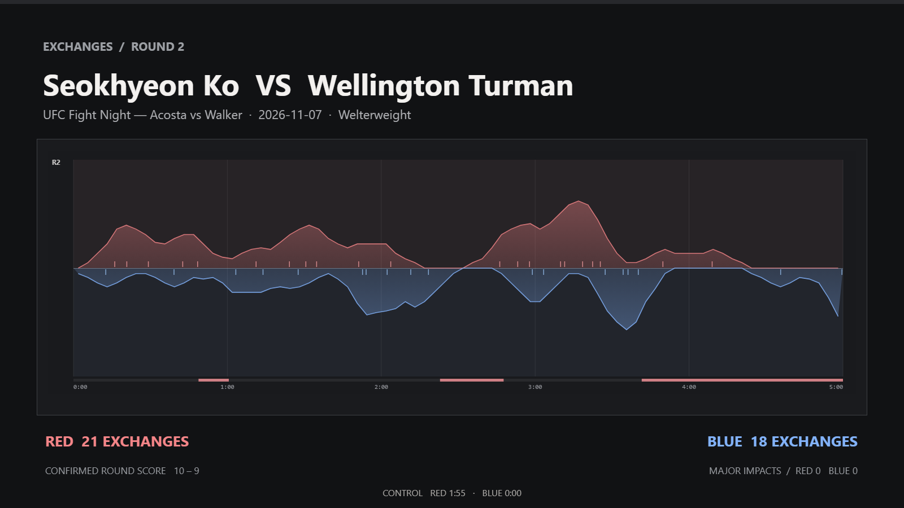
</figure>

Round 3: Ko comes out early with a takedown and controls Turman almost the entirety of the fight and landing shots. Turman ultimately had no offense or anything to offer this round and gets beaten and controlled pretty handily. 30-26

<section class="article-html-visual">
<figure class="article-inline-image article-inline-image--break article-inline-image--center article-inline-image--full" data-writer-media-id="media-97452db7" data-media-flow="break" data-media-align="center" data-media-width="100" style="--media-width:100%;">
  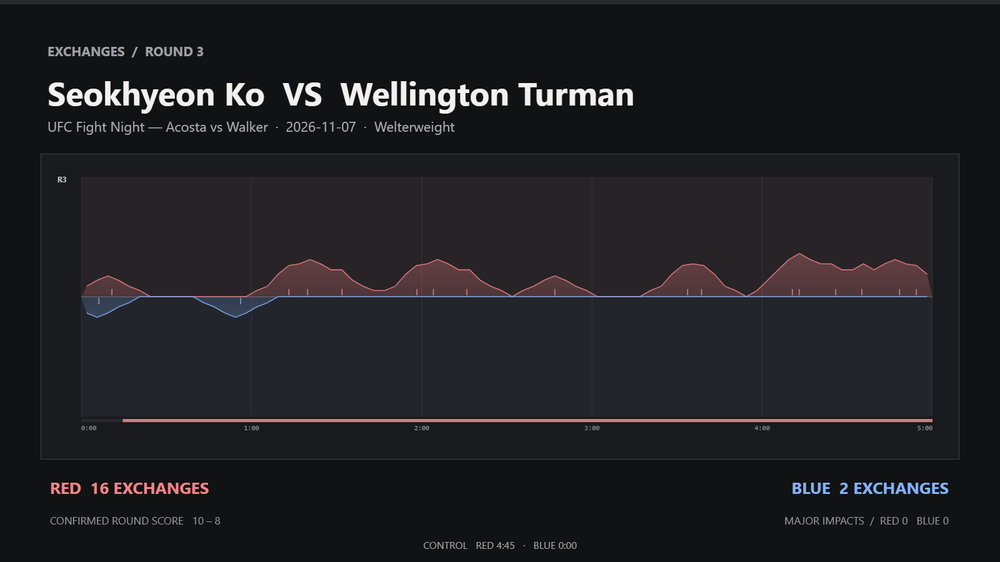
</figure>
</section>
---

### Jonny Parsons vs. José Souza — *José Souza wins VIA knockout in round 1 (right uppercut, left hook)*
Round 1: Parsons best work of the fight was slipping the jab and landing leg kicks. He had trouble with the range because Souza is massive. He threw a lot of head kicks that missed the mark. Souza best work came from his jab and knees. He had Parsons worried about the kicks, too. Once Parsons committed to his strikes though it was lights out. 

<figure class="article-inline-video article-inline-video--break article-inline-video--center article-inline-image--break article-inline-image--center" data-writer-media-id="media-690b431e" data-media-flow="break" data-media-align="center" data-media-width="100" style="--media-width:100%;">
  

    <video loop muted playsinline preload="none" src="https://github.com/MatlockFT/Matlock/releases/download/writer-media-2026-11/ufc-vegas-124-live-results-scoring-video-20261107-161250-340.mp4" aria-label="Article video"></video>
  

</figure>

<figure class="article-inline-image article-inline-image--break article-inline-image--center article-inline-video--break article-inline-video--center" data-writer-media-id="media-97452db7" data-media-flow="break" data-media-align="center" data-media-width="100" style="--media-width:100%;">
  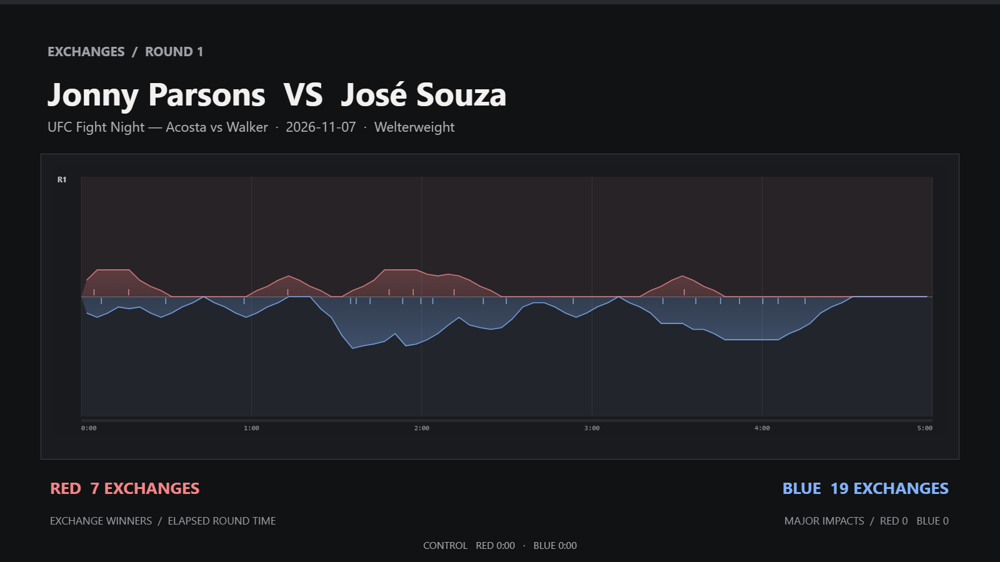
</figure>

---

[Full-card breakdown and predictions](/2026/11/05/ufc-vegas-124-cortes-acosta-vs-walker.html)
