UFC 334 takes place November 14 at Madison Square Garden in New York City. Follow the results below as the card unfolds. I'll add my scoring and brief fight notes throughout the night.

## Main card

### Ciryl Gane vs. Josh Hokit (Ciryl Gane wins via unanimous decision)

Round 1:
A ferocious pace is set by Hokit, who charges across the octagon for a takedown. Gane gets back up, and the majority of the round is Gane circling and jabbing, throwing the occasional uppercut as Hokit relentlessly charges forward with his head on the centerline. Hokit lands some clean shots, and DC and Rogan scream their brains out whenever he does. Hokit lifts Gane above his head and slams him to the ground near the end of the round. 10-9 Gane.
It should be noted that Gane did get an eye poke in there as he tried to frame off Hokit's face and create separation.

<figure class="article-inline-image article-inline-image--break article-inline-image--center" data-writer-media-id="media-10653a5a" data-media-flow="break" data-media-align="center" data-media-width="100" style="--media-width:100%;">
  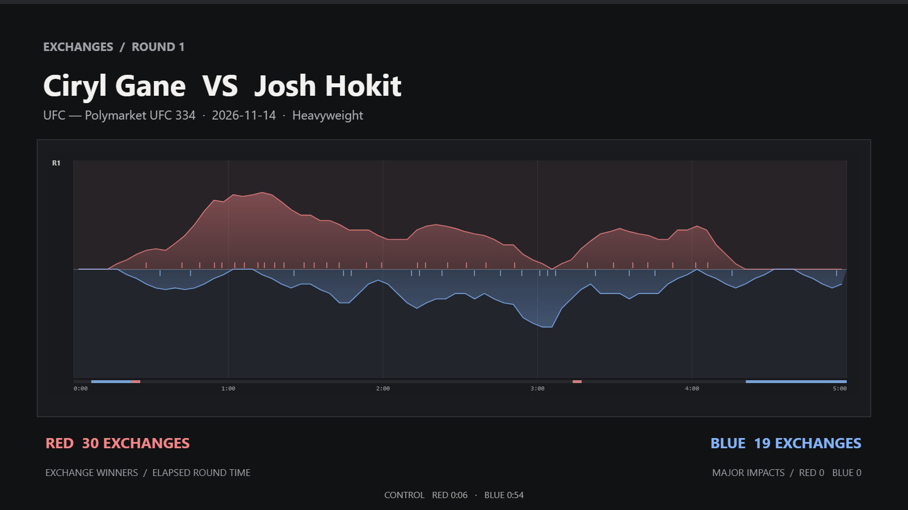
</figure>

Round 2: More of the same as Hokit recklessly closes distance and Gane makes him pay for it with knees and jabs. They both spend quite a bit of time in the clinch, hanging on to the single collar, though Josh isn't really doing much damage from there. A couple of heavier blows land from Hokit, and DC and Rogan again explode as if he rocked Gane, but I don't think he did. The punch lands clean, for sure, but by the time it actually reaches Gane, it appears to have lost a lot of its momentum and pop. Quite a few failed takedowns as Gane sprawls on Hokit, too. Certainly a closer round, but it's pretty clear to me that Gane landed more. 10-9 Gane.

<figure class="article-inline-image article-inline-image--break article-inline-image--center" data-writer-media-id="media-542989ab" data-media-flow="break" data-media-align="center" data-media-width="100" style="--media-width:100%;">
  
</figure>

Round 3: This is by far Hokit's best round, as Gane is looking completely gassed. To be fair, they both look pretty tired, but Hokit is moving forward and Gane is stepping back. The majority of the round takes place in the clinch, where Hokit's most effective clean shot is an elbow to the dome. It's almost the only strike he lands aside from foot stomps against the cage. Gane is still landing jabs and crosses here and there, but Hokit fought a good round, eliminating the distance game as best he could. 10-9 Hokit.

<figure class="article-inline-image article-inline-image--break article-inline-image--center" data-writer-media-id="media-ee380a6c" data-media-flow="break" data-media-align="center" data-media-width="100" style="--media-width:100%;">
  
</figure>

Round 4: Almost a repeat of round 3, as a majority of the fight takes place in a 50/50 position in the clinch. However, Gane finds way more opportunities to land strikes this time around. Gane lands better shots at range and in the clinch. Hokit spends much more time leaning on Gane and throwing foot stomps. Hokit's punches in the clinch almost don't even count as strikes, as they're so ineffective and labored. Gane's are, too, but at least he's landing knees. Close round, and I think some may see it for Hokit just because of optics, but I think it's a pretty clear round for Gane. He lands more volume at range and in the clinch, so I don't think the aggression or control time comes into play for Hokit. 10-9 Gane.

<figure class="article-inline-image article-inline-image--break article-inline-image--center" data-writer-media-id="media-be58deed" data-media-flow="break" data-media-align="center" data-media-width="100" style="--media-width:100%;">
  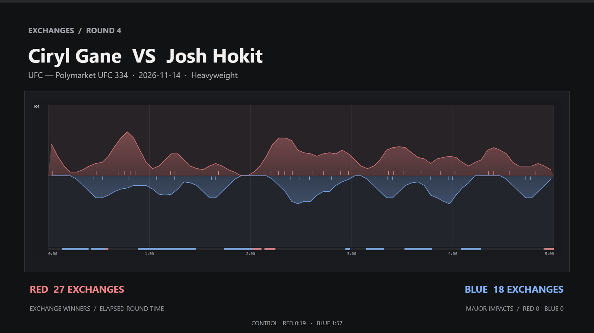
</figure>

Round 5: Hokit charges across the octagon for a takedown attempt, which Gane thwarts. He tries for another and fails again. Gane makes him pay with shots in between. They spend more time in the clinch, where Gane is landing the better shots. Hokit lands a couple of shots. I cannot overstate how ridiculously enthusiastic Rogan and DC are every time Hokit lands one clean punch. I understand the crowd cheering, but if you had a blindfold on, you'd think Hokit was beating the shit out of Gane. It's quite the opposite in reality. Hokit has nothing for Gane in round 5. 10-9 Gane.

<figure class="article-inline-image article-inline-image--break article-inline-image--center" data-writer-media-id="media-a68b5268" data-media-flow="break" data-media-align="center" data-media-width="100" style="--media-width:100%;">
  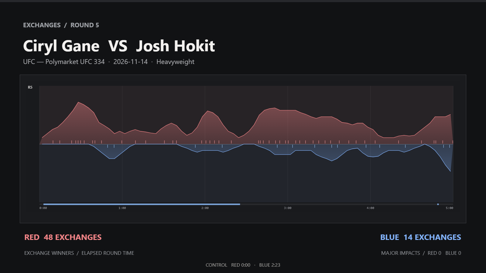
</figure>

An incredibly sloppy fight that essentially looked like Gane, despite being gassed, outclassing Hokit in every facet of MMA. Gane could've benefited from a more dynamic game in the clinch, and he certainly did not throw anywhere near the number of kicks he usually does. I think not kicking Hokit was Gane's biggest misstep in this fight. Sure, he may have been more vulnerable to takedowns or allowed Hokit to close distance, but the pros would've easily outweighed the cons. The one leg kick I remember him throwing moved Hokit's entire body. Had he kept that up, Hokit barely would've been standing by round 5, as he's always charging forward. This fight is further proof that heavyweight is in shambles.

<figure class="article-inline-video article-inline-video--break article-inline-video--center" data-writer-media-id="media-e68272dd" data-media-flow="break" data-media-align="center" data-media-width="100" style="--media-width:100%;">
  

    <video loop muted playsinline preload="none" src="https://github.com/MatlockFT/Matlock/releases/download/writer-media-2026-11/ufc-334-live-results-scoring-video-20261115-175432-670.mp4" aria-label="Article video"></video>
  

</figure>

My card: 49-46 Gane, and that is the only acceptable answer. I find that a lot of fans online scored the first three rounds for Hokit, and objectively, I can understand where they're coming from. "This is one of the closest title fights in UFC history according to the Verdict Scorecard."

<figure class="article-inline-image article-inline-image--break article-inline-image--center" data-writer-media-id="media-1e711030" data-media-flow="break" data-media-align="center" data-media-width="100" style="--media-width:100%;">
  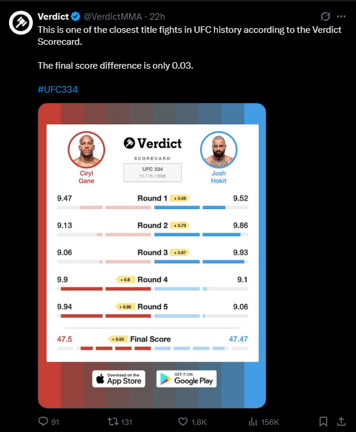
</figure>

On the surface, Hokit is pressing forward, trying for takedowns, dictating where the fight takes place, and throwing shots in the clinch. In terms of damage, neither fighter landed many visibly damaging blows, but Gane landed much more volume and attacked the body more. Body shots are criminally undervalued in the UFC, but they're cumulative nonetheless. Gane was easily the more effective striker of the two, and just because he was backing off and circling doesn't mean he was ineffective. That's how he fights, and that's how you fight Josh Hokit. He runs into punches. A judge can certainly appreciate Hokit's aggressiveness and fighting-area control, but those only come into play if the judge cannot identify even a marginal advantage in effective striking or grappling. Hokit's takedowns were largely ineffective in this fight, and though he initiated the clinch, they both exchanged strikes. Hokit favored punches to the head, and Gane favored knees to the body. The knees to the body were definitely more effective and stronger than Hokit's very weak punches to the head. Hokit's best work came from his elbows in the clinch, which was evident in the only round I scored for him: round 3. If Hokit's forward pressure had allowed him to avoid taking shots and land his punches on the way into the clinch, then sure, he'd have won the fight. But he didn't. As we all pointed out prior to the fight, closing that distance was going to be a challenge. I think it's incredibly generous to score any round outside of round 3 for Josh Hokit. That is my opinion.

### Kayla Harrison vs. Amanda Nunes (Kayla Harrison wins via fourth-round submission, rear-naked choke)

Round 1: Both meet in the center and play the distance game, which is a tremendously bad idea for Harrison. Nunes launches shots from very far out of range, but she's getting closer. She lands a few, and Harrison is getting desperate for these takedowns, which Amanda is defending well. Eventually, Kayla gets a throw, traps Nunes in a headlock with one arm pinned, and is free to punch her in the face, which she does. Not much heat in these punches, however, and no visible damage despite being in such a dominant position. This was much needed for Kayla Harrison, as she was surely losing the fight up to that point. 10-9 Harrison.

<figure class="article-inline-image article-inline-image--break article-inline-image--center" data-writer-media-id="media-5d26573c" data-media-flow="break" data-media-align="center" data-media-width="100" style="--media-width:100%;">
  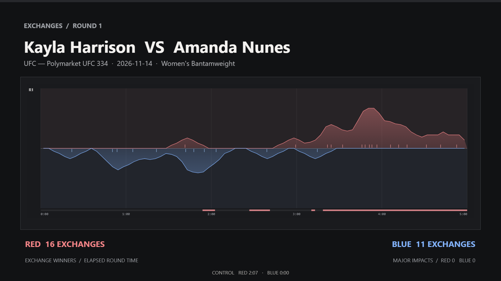
</figure>

Round 2: Harrison gets pieced up at range again, but Kayla ties her up. They spend a significant amount of time against the cage, with Amanda holding her there and even getting a takedown. Eventually, Kayla gets another throw, an impressive one where Nunes lands hard on the mat. Harrison secures a crucifix once again and lands elbows. She maintains this position for the rest of the round. 10-9 Harrison.

<figure class="article-inline-image article-inline-image--break article-inline-image--center" data-writer-media-id="media-aeeab4a9" data-media-flow="break" data-media-align="center" data-media-width="100" style="--media-width:100%;">
  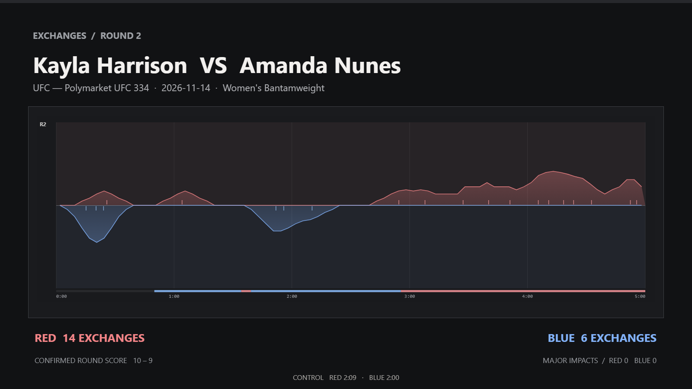
</figure>

Round 3: At range, Nunes lands a couple of shots. They then end up against the cage, with Amanda holding position, but I think Kayla might be hanging on to her neck. They stay there for a while before Amanda gets another takedown. Amanda actually takes the back and threatens with the RNC, but she eventually gets reversed, and Kayla is on top. Kayla lands a sharp elbow that cuts Amanda and ends the round with ground-and-pound. 10-9 Harrison.

<figure class="article-inline-image article-inline-image--break article-inline-image--center" data-writer-media-id="media-f544b1a7" data-media-flow="break" data-media-align="center" data-media-width="100" style="--media-width:100%;">
  
</figure>

Round 4: Nunes looks gassed. Her legs look heavy, and she's nowhere near as light or agile with her footwork. She still throws a couple of bombs, though, which Kayla takes on the chin. Kayla tries to tie her up, but to no avail. Nunes throws a front kick to the body, and Kayla catches it. Nunes loses her balance and falls, crawling on her hands and knees as Kayla sprints forward, takes the back, secures a choke, and Amanda taps. Fight over.

An incredibly curious game plan from Amanda, who was more than happy to wrestle and grapple with Kayla Harrison, which is quite baffling. The few times Nunes did throw, she landed. But overall, she looked slow and looked even worse in the fourth when she gassed out.

This fight, despite some of the struggles on the feet, is the best Kayla Harrison has looked. Her judo really came into play here, and she had some of the best throws of her career. Her judo has always worked in MMA, but she'd never had that highlight-reel level of trips and throws in the UFC like Ronda did. In this fight, she had a couple, and they were critical to her success. Amanda had her moments, too, but she ultimately couldn't maintain a dominant position, and those exchanges subsequently gassed her out.

---

### Caio Borralho vs. Yousri Belgaroui

Round 1: At range, Caio is throwing very long jabs to the body and getting out of range, while Belgaroui is throwing kicks that are completely out of range. Caio gets the fight to the ground and establishes significant control time while landing a couple of shots. Back on the feet, Belgaroui doesn't have long to work but throws a heavy head kick. Caio blocks it, but it might've stung him a bit. Belgaroui pressures and lands a couple more punches. Too little, too late. 10-9 Caio Borralho.

<figure class="article-inline-image article-inline-image--break article-inline-image--center" data-writer-media-id="media-c8850b6c" data-media-flow="break" data-media-align="center" data-media-width="100" style="--media-width:100%;">
  
</figure>

Round 2: Caio is doing little at the start of this round, just getting kicked and letting Belgaroui establish his game. Caio does land what looks like one good check left hook, which gets Belgaroui backing up for a second. Caio closes distance and starts grappling. Some control time before they're back at range, where Belgaroui is back to landing shots. But again, Caio finds some success of his own in striking. More control time for Caio up until the end. Actually a close round, and as far as optics go, I could see giving it to Borralho, but I can't forget how the round started. 10-9 Belgaroui.

<figure class="article-inline-image article-inline-image--break article-inline-image--center" data-writer-media-id="media-599f128b" data-media-flow="break" data-media-align="center" data-media-width="100" style="--media-width:100%;">
  
</figure>
Round 3: Belgaroui is doing well at range, landing his shots. Caio has some responses, but not much, so he tries for a takedown. Gets it. Not much done on the ground as Belgaroui works back to his feet. Belgaroui starts landing again, including a big knee that has Caio backing up. Caio lands a heavy counter as Belgaroui is about to put the pressure on. They're both good, though. A couple more shots land for Belgaroui, and he's taken down again. Not much done with it. Belgaroui gets back to his feet, with Borralho keeping him against the cage and landing a couple of knees to the legs. This seems to be a clear round for Belgaroui. 10-9 Belgaroui.

<figure class="article-inline-image article-inline-image--break article-inline-image--center" data-writer-media-id="media-c1496128" data-media-flow="break" data-media-align="center" data-media-width="100" style="--media-width:100%;">
  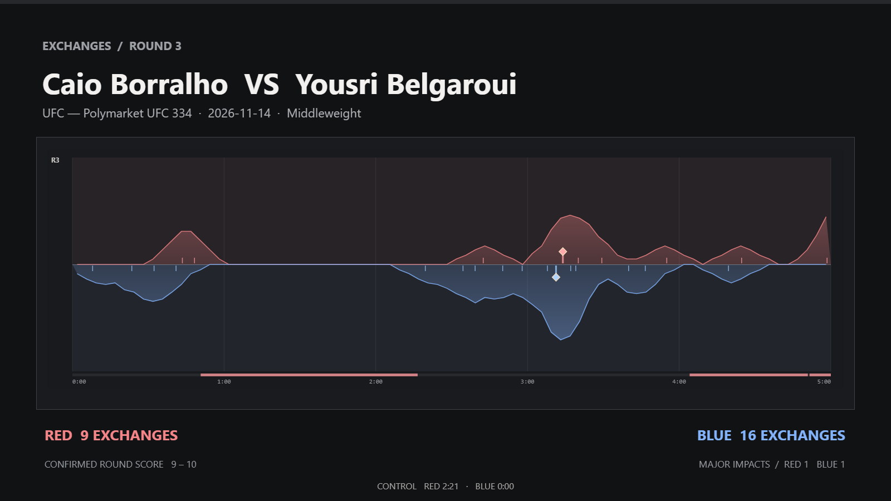
</figure>

My card: 29-28 Belgaroui
Judges: 30-27 x3, Caio Borralho

Not too surprised by the judges' scorecards, as Caio often had Belgaroui on the back foot and working to get back to his feet, though I didn't see much threatening offense. Belgaroui had the head kicks and knees to the body whenever Caio closed for a takedown. That, to me, isn't indicative of offense that prevents meaningful counters. Immediate damage takes priority over cumulative damage, but it's damage nonetheless. I think if I spend less time focusing on the X's and O's and just ask who felt like they had the more effective offense as a whole, Caio Borralho would come to mind. Though the statistics do back my live scoring, where I felt Belgaroui had the more meaningful striking offense on the feet. I disagree with the cards, but I understand the perspective.
---

### Uroš Medić vs. Kevin Holland (Draw)

Round 1: Kevin Holland is fighting very long, mostly implementing a kicking game and keeping Medić at range. Medić is having a hell of a time trying to find Holland and get through his reach. Medić tries to throw but gets countered with several uppercuts from Holland that drop him. He sort of looked off-balance, to be fair, but Holland tries to tie up a D'Arce (maybe an anaconda—I'm unsure). Medić survives, though it looked grim for a bit. 10-9 Holland.

<figure class="article-inline-image article-inline-image--break article-inline-image--center" data-writer-media-id="media-d337dfcb" data-media-flow="break" data-media-align="center" data-media-width="100" style="--media-width:100%;">
  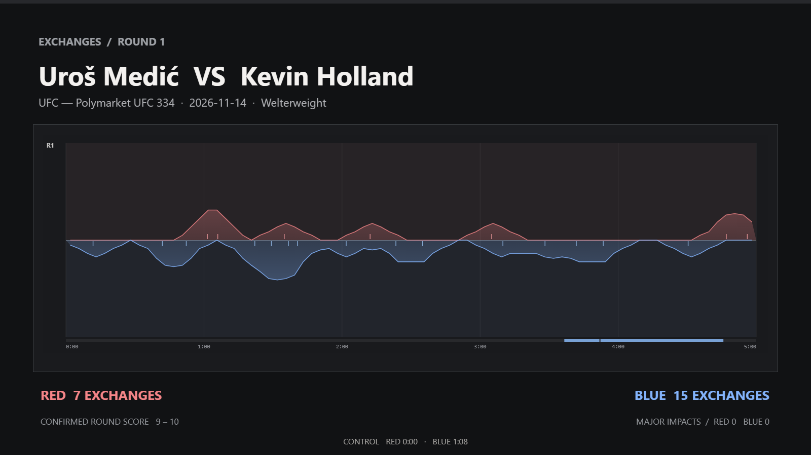
</figure>

Round 2: Both are at range kicking again, with Medić crashing in at times to land shots. It's sort of working, but not nearly enough because the volume just isn't there. Medić lands two low blows, the second of which Holland milks for the full five minutes. Marc Goddard deducts a point from Medić. It's a razor-close round thus far. Back to Holland kicking, which is kind of ineffective, but it's the only thing happening. Holland tries for a takedown, but Medić gets back up. They end the round with Medić's back to the fence and Holland holding him there, trying to land shoulder strikes. Close round, but it's a 10-9 for Holland, adjusted to 10-8 with the point deduction.

<figure class="article-inline-image article-inline-image--break article-inline-image--center" data-writer-media-id="media-b80f64b3" data-media-flow="break" data-media-align="center" data-media-width="100" style="--media-width:100%;">
  
</figure>
Round 3: Kevin continues keeping Medić at range with front-leg side kicks targeting Medić's body and leg. He's exclusively winning this fight on those strikes. Everything else Holland attempts is embarrassingly bad, as he keeps losing his footing. Medić finds a couple of opportunities to land heavy shots, one a head kick and the others hooks. Medić's best round by far. Strange fight. 10-9 Medić.

My card: 29-27 Holland
Judges get it wrong with this one: 28-28; 29-27 (Medić); 28-28. Those are some insane scores. I understand Holland didn't exactly look like a world-beater when he exclusively used front-leg side kicks that landed with little impact, but it was all the fight could really be scored on in the first two rounds. Not to mention, Holland held Medić in a submission for about two minutes in the first round. David Bruce's card is a head-scratcher.

<figure class="article-inline-image article-inline-image--break article-inline-image--center" data-writer-media-id="media-a350b4a4" data-media-flow="break" data-media-align="center" data-media-width="100" style="--media-width:100%;">
  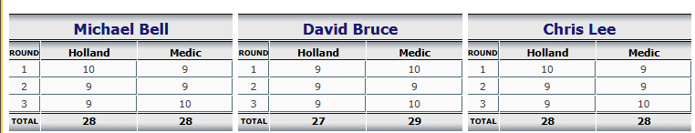
</figure>

---

### Bilal Hasan vs. Luis Gurule (Luis Gurule wins via split decision)

Round 1: Bilal Hasan comes out doing what he does, constantly attacking with kicks and punches and staying mobile. Gurule is laser-focused, slowly marching forward through the onslaught, not letting Hasan operate at range. He's cutting off the cage and trying to land his punches, but without much success. He does land one clean shot as Hasan is moving backward, knocking him down, but I think Hasan was really off-balance because he was right back up on his feet. 10-9 Hasan.

<figure class="article-inline-image article-inline-image--break article-inline-image--center" data-writer-media-id="media-812b17cc" data-media-flow="break" data-media-align="center" data-media-width="100" style="--media-width:100%;">
  
</figure>

Round 2: Some more success from Bilal Hasan at range, with Gurule doing minimal work on the feet. Gurule is inching forward and trying to land counters. He tries for a couple of takedowns that fail, and he's catching kicks now. He eventually gets a takedown and lands a good elbow. This is a close round, and one could argue that the most damaging blow came from Gurule on the mat. 10-9 Hasan.

<figure class="article-inline-image article-inline-image--break article-inline-image--center" data-writer-media-id="media-7654f432" data-media-flow="break" data-media-align="center" data-media-width="100" style="--media-width:100%;">
  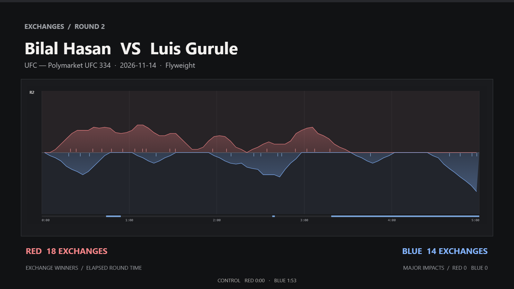
</figure>

Round 3: Hasan comes out fast, landing good shots. I think Hasan cut Gurule as they were headed to the mat. Gurule holds a dominant top position with pitter-patter ground-and-pound. 10-9 Gurule.

<figure class="article-inline-image article-inline-image--break article-inline-image--center" data-writer-media-id="media-08b3611e" data-media-flow="break" data-media-align="center" data-media-width="100" style="--media-width:100%;">
  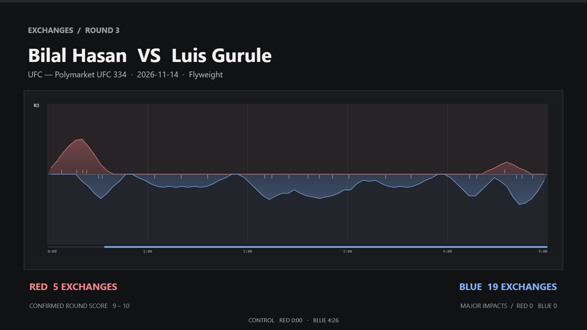
</figure>

My card: 29-28 Hasan.
Judges: 29-28 Hasan; 29-28 Gurule; 29-28 Luis Gurule.

---

## Prelims

### Stephen Thompson vs. Charles Radtke (Stephen Thompson wins via round 3 TKO)

The story of this fight is that Thompson most likely loses the first round as Radtke closes distance and keeps him down. Thompson lands good shots throughout the fight, and as Radtke gases out, Thompson starts beating the shit out of him until a hook kick (I think) knocks Radtke down. Good.

---

### Drew Dober vs. Chris Duncan (Chris Duncan wins via unanimous decision, 30-27 x2, 29-28)

Round 1: Heavy exchanges, but Duncan is getting the best of Dober in the open-stance matchup, especially with these kicks. Duncan lands a laser-beam pull counter that makes Dober's knees give way. He keeps standing, however. Great round for Duncan, who may have broken his foot. 10-9 Duncan.

Round 2: Pure kickboxing round, with Duncan having more volume, more impact, and the better exchanges. Dober lands some good hits, but he took the round off. 10-9 Duncan.

Round 3: The pace has slowed substantially. They're both bombing in exchanges, and this is Dober's best round thus far. He rocks Duncan, but Duncan recovers and gets it to the ground. Through pure volume, pace, a takedown, control, and elbows, Duncan wins this round on my card, too. 10-9 Duncan.

My score: 30-27 Duncan

---

### Jim Miller vs. Terrance McKinney (Terrance McKinney wins via first-round knockout at 1:53, straight left and ground-and-pound)

Round 1: Of course, I want Miller to win this fight, but the fight game has no feelings, and the pick is McKinney. The jab is working for McKinney, and it's fucking up Miller, who's cut open near the eye. Good counter from Miller lands. McKinney stays in his face. He just dropped Miller and is following up. Fight over.

---

### Donte Johnson vs. Cesar Almeida (Cesar Almeida wins via first-round TKO)

Round 1: Donte Johnson comes out aggressive. Almeida is very reserved and reading. Wow, Johnson looks very sloppy right now, and his footwork is pretty bad. He's a bit nervous, I think. Almeida lands a sharp right hand. Fans and judges are gonna fuck this fight up because Johnson is throwing a whole lot and nothing is landing, whereas Almeida is sharp and quiet with his counters. Donte just threw a Superman punch with his chin in the air. He's gonna get domed. Yep. Donte gets dropped and is trying to survive. He's back to his feet and throwing leather with Almeida. Terrible idea. Donte gets dropped again. Ref stops it.

---

## Early prelims

### Jared Gordon vs. Melquizael Costa (Melquizael Costa wins via unanimous decision, 29-28 x3)

Round 1: Gordon comes out looking confident, but Costa is sticking and moving and landing these POWERFUL head kicks that render Gordon completely defensive. He's struggling to close the gap. He pushes Costa against the cage at the end, but they separate, and Costa lands a turning side kick to the body that launches Gordon to the ground. 10-9 Costa.

<figure class="article-inline-image article-inline-image--break article-inline-image--center" data-writer-media-id="media-21f8e02c" data-media-flow="break" data-media-align="center" data-media-width="100" style="--media-width:100%;">
  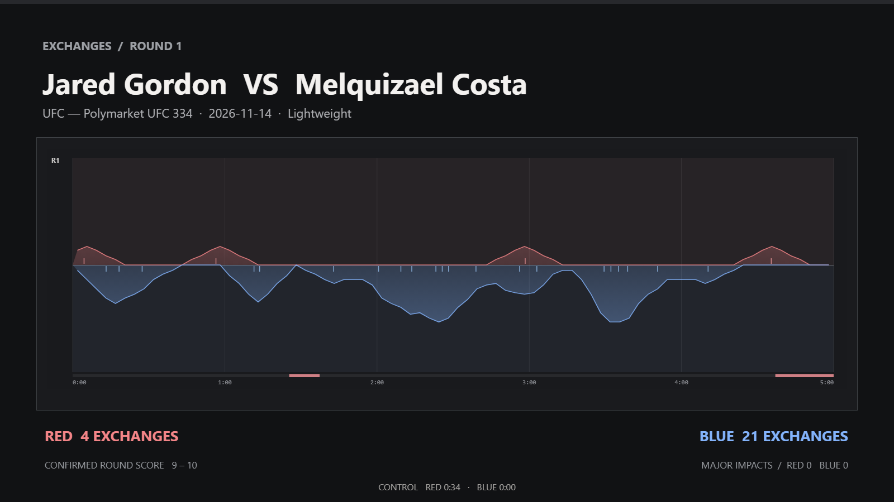
</figure>

Round 2: Gordon comes out fast, trying to close distance, but Costa is hammering him while moving backward. Inside body kick lands. That was nasty. Gordon gets the takedown, gets stuck in a triangle, but escapes. He takes Costa's back. This is huge for him. Trying to sink in a choke, he's got the hooks in—my bad, one hook in. He abandons it for punches. Costa moves, Gordon tries to regain the back, and Costa stands up. Gordon abandons the backpack. Gordon is now working him against the cage, landing shots. Costa gets a trip takedown. Back to the cage, back to the mat. Savvy moves from Gordon, who's showing his experience. He ends the round on top, landing shots. We got a fight! 10-9 Gordon.

<figure class="article-inline-image article-inline-image--break article-inline-image--center" data-writer-media-id="media-ee854acf" data-media-flow="break" data-media-align="center" data-media-width="100" style="--media-width:100%;">
  
</figure>

Round 3: Gordon eats shots going in but wrestles and gets Costa down. They get back up and are fighting at range. Gordon is eating a lot of shots, and they're both exhausted. Gordon is failing some wrestling attempts here. Gets him down near the end, and Costa smartly ends the round going for a submission. That's a 10-9 Costa on my card, but it's going to be close. It comes down to how the judges score round 3.

<figure class="article-inline-image article-inline-image--break article-inline-image--center" data-writer-media-id="media-c5fa6c46" data-media-flow="break" data-media-align="center" data-media-width="100" style="--media-width:100%;">
  
</figure>

My card: 29-28 Costa.

---

### Macy Chiasson vs. Bia Mesquita (Bia Mesquita wins via first-round submission, rear-naked choke, at 3:23)

Round 1: Chiasson is circling on the outside, using good footwork and effective use of the dart. However, her punches are paper, and Mesquita has some power in her hands. They trade shots, and Mesquita clearly lands the heavier one. She gets a body lock and slams Chiasson to the mat. Powerful elbows and punches on the ground. Chiasson tries to escape, gives up her back, and gets caught in a rear-naked choke. Tap. Very impressive victory for Bia Mesquita.

---

### Alatengheili vs. Juan Diaz (Juan Diaz wins via unanimous decision, 30-27 x3)

Round 1: Alatengheili could not find his range. Most shots missed the mark, and his takedowns weren't coming either. Juan Diaz essentially outboxes him to a 10-9 round. 10-9 Diaz.

<figure class="article-inline-image article-inline-image--break article-inline-image--center" data-writer-media-id="media-e9c19a3d" data-media-flow="break" data-media-align="center" data-media-width="100" style="--media-width:100%;">
  
</figure>

Round 2: Alatengheili has absolutely nothing for Diaz. No adjustments except for maybe a jab at the very end, but Diaz outboxes this dude completely and keeps the fight where he wants it. No rocking Alatengheili or significant damage, but Alatengheili effectively has nothing. 10-8 Diaz.

<figure class="article-inline-image article-inline-image--break article-inline-image--center" data-writer-media-id="media-8d033a16" data-media-flow="break" data-media-align="center" data-media-width="100" style="--media-width:100%;">
  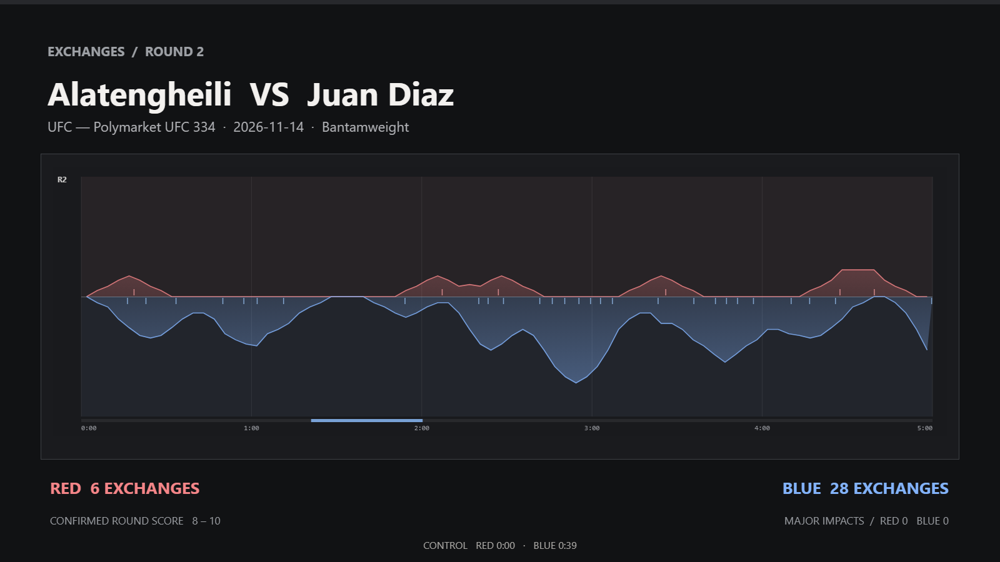
</figure>

Round 3: More of the same, with Diaz outstriking and outboxing Alatengheili. Alatengheili lands one good shot near the end of the fight that seems to rock Diaz momentarily, but it's way too little, way too late. 10-8 Diaz.

<figure class="article-inline-image article-inline-image--break article-inline-image--center" data-writer-media-id="media-89a78f63" data-media-flow="break" data-media-align="center" data-media-width="100" style="--media-width:100%;">
  
</figure>

My card: 30-25 Juan Diaz

---

### Evan Elder vs. Samuel Sanches (Evan Elder wins via unanimous decision 30-26 x3)

Round 1: Both trade jabs. Elder starts closing and throwing bombs. A left hook lands and rocks Sanches. Elder gets it to the ground. Back up, now separated, Elder looks tired. Elder drops Sanches at the end of the round. 10-9 Elder.

<figure class="article-inline-image article-inline-image--break article-inline-image--center" data-writer-media-id="media-1ffb3bbe" data-media-flow="break" data-media-align="center" data-media-width="100" style="--media-width:100%;">
  
</figure>

Round 2: Elder gets dropped with a jab. More off-balance, I think, but still solid. The story of this fight is that Elder is landing with more volume and power but gets picked apart between sprints. Takedown for Elder to close the round. 10-9 Elder (20-18 overall).

<figure class="article-inline-image article-inline-image--break article-inline-image--center" data-writer-media-id="media-f961e334" data-media-flow="break" data-media-align="center" data-media-width="100" style="--media-width:100%;">
  
</figure>

Round 3: They trade jabs, and Elder tries for a takedown. A cut opens, I think, on top of Elder's head. Sanches gets back to his feet, but Elder isn't letting go of this body lock, and he pushes him across the octagon back to the fence. Elder is crashing into the clinch over and over. He's exhausted. Sanches is picking him apart at range, but Elder gets a takedown. In round 1, Sanches grabbed the fence, and he just did it again to prevent the takedown. The ref deducts a point. They're slugging it out in the center of the octagon. Elder gets the better of it and lands another takedown.

<figure class="article-inline-image article-inline-image--break article-inline-image--center" data-writer-media-id="media-e375e5a4" data-media-flow="break" data-media-align="center" data-media-width="100" style="--media-width:100%;">
  
</figure>

My card: Evan Elder, 30-26.

---

[Full-card breakdown and predictions](/2026/11/08/ufc-334-gane-vs-hokit.html)
