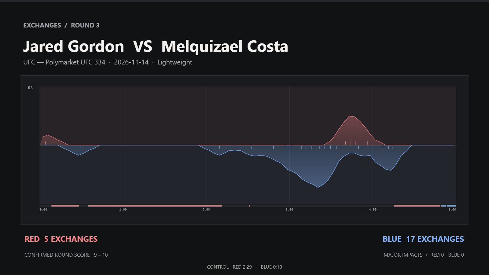
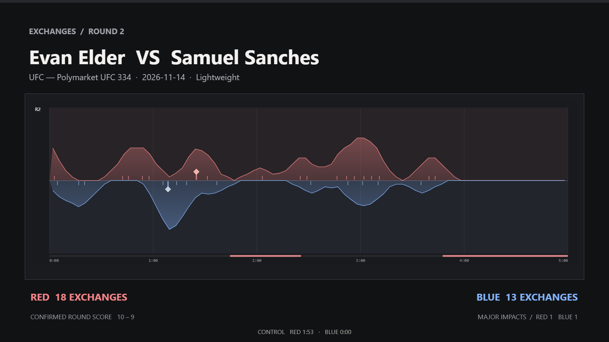

UFC 334 takes place November 14 at Madison Square Garden in New York City. Follow the results below as the card unfolds. I'll add my scoring and brief fight notes throughout the night.

## Main card

### Ciryl Gane vs. Josh Hokit

Round 1:
A ferocious pace set by Hokit who charges across the octagon for a takedown. Gane gets back up and the majority of this fight Gane circling and jabbing, throwing the occasional uppercut as Hokit relentlessly charges forward with his head on the centerline. Hokit does get some clean shots in there and DC, Rogan are screaming their brains out whenever he does. Hokit lifts Gane above his head and slams him to the ground near the end of the round. 10-9 Gane
should be noted Gane did get an eye poke in there as he tried to frame off Hokit's face and create separation. 

<figure class="article-inline-image article-inline-image--break article-inline-image--center" data-writer-media-id="media-10653a5a" data-media-flow="break" data-media-align="center" data-media-width="100" style="--media-width:100%;">
  
</figure>

Round 2: 

---

### Kayla Harrison vs. Amanda Nunes

Round 1:

---

### Caio Borralho vs. Yousri Belgaroui

Round 1:

---

### Uroš Medić vs. Kevin Holland

Round 1:

---

### Bilal Hasan vs. Luis Gurule

Round 1: Bilal Hasan comes out doing what he does constantly attacking with kicks and punches and staying mobile. Laser focused is Gurule, slowly marching forward through the onslaught, he is clearly wanting to get this to the ground but he is betting on his toughness against Hasan's conditioning. 10-9 Hasan.

Round 2 and 3: Hasan does well at range in round to but he does get taken down. 10-9 for Gurule in 2 & 3.

I legit thought Luis Gurule was gonna get robbed in that fight. 
29-28 Hasan; 29-28 Gurule; 29-28 Luis Gurule

---

## Prelims

### Stephen Thompson vs. Charles Radtke (Stephen Thompson wins via round 3 TKO)

Story of this fight is Thompson loses first round most likely as Radtke closes distance to keep Thompson down. Thompson landed good shots throughout the fight and as Radtke gassed out, Thompson started beating the shit out of him until a hook kick ( I think) knocks down Radtke. Good. Fuck Radtke, an absolute fucking loser. 

---

### Drew Dober vs. Chris Duncan (Chris Duncan wins via unanimous decision 30-27x2, 29-28)

Round 1: Heavy exchanges but Duncan getting the best of Dober with the open stance matchup, especially with these kicks. Duncan lands a laser beam pull counter that gets Dober's knees to give way. He keeps standing however. Great round for Duncan who may have broken his foot. 10-9 Duncan

Round 2: Pure kickboxing round with Duncan having more volume, more impact, and the better exchanges. Dober with some good hits but he took the round off. 10-9 Duncan

Round 3: Pace has slowed substantially. They're both bombing in exchanges and this is Dober's best round thus far. He rocks Duncan but Duncan does recover, gets it to the ground. Through pure volume and pace, and a takedown with control and elbows, Duncan wins this round on my cards, too. 10-9 Duncan.

My score: 30-27 Duncan

---

### Jim Miller vs. Terrance McKinney (Terrance McKinney wins via first round knockout 1:53) (straight Left + ground and pound)

Round 1: Of course, I want Miller to win this fight but the fight game has no feelings and the pick is McKinney. Jab working for McKinney and it's fucking up Miller, cut open on the eye. Good counter from Miller lands. McKinney staying in his face. He just dropped Miller, following up, fight over.

---

### Donte Johnson vs. Cesar Almeida (Cesar Almeida wins via TKO round 1)

Round 1: Donte Johnson comes out aggressive. Almeida very reserved and reading. Wow, Johnson looking very sloppy right now and his footwork is pretty bad. He's a bit nervous, I think. Almeida with a sharp right hand. Fans and judges are gonna fuck this fight because Johnson is throwing a whole lot and nothing is landing whereas Almeida is sharp and quiet with his counters. Donte just threw a superman punch with his chin in the air, he's gonna get domed. Yep. Donte dropped and is trying to survive. He's back to his feet and throwing leather with Almeida, terrible idea. Donte dropped again. Ref stops it. 

---

## Early prelims

### Jared Gordon vs. Melquizael Costa (Melquizael Costa wins via unanimous decisions 29-28 x3)

Round 1: Gordon came out looking confident but Costa sticking and moving and landing these POWERFUL head kick that are rendering Gordon completely defensive. He is struggling to close the gap. He pushes Costa against the cage at the end but they separate and Costa lands a turning side kick to the body that launches Gordon to the ground. 10-9 Costa

<figure class="article-inline-image article-inline-image--break article-inline-image--center" data-writer-media-id="media-21f8e02c" data-media-flow="break" data-media-align="center" data-media-width="100" style="--media-width:100%;">
  
</figure>

Round 2: Gordon comes out fast, trying to close distance but Costa is hammering him moving backward, inside body kick lands, that was nasty. Gordon gets the takedown, stuck in a triangle but escapes. He takes Costa back, this is huge for him. Trying to sink in choke, he's got the hooks in - my bad, one hook in, he abandons it for punches, Costa moves, Gordon tries for back gain and Costa stands up, Gordon abandons the backpack. Gordon now working him against the cage, landing shots. Costa trip takedown, back to the cage, back to the mat. Savvy moves from Gordon who is showing his experience. He ends the Round on top landing shots. We got a fight! 10-9 Gordon. 

<figure class="article-inline-image article-inline-image--break article-inline-image--center" data-writer-media-id="media-ee854acf" data-media-flow="break" data-media-align="center" data-media-width="100" style="--media-width:100%;">
  
</figure>

Round 3: Gordon eats shots going in, but wrestles, gets Costa down. Gets back up and they're fighting at range. Gordon eating a lot of shots and they both are exhausted. Gordon failing some wrestling here. Gets him down near the end and Costa smartly ends the round going for a submission. That's a 10-9 Costa on my card but its going to be close. It comes down to how the judges score round 3.

<figure class="article-inline-image article-inline-image--break article-inline-image--center" data-writer-media-id="media-c5fa6c46" data-media-flow="break" data-media-align="center" data-media-width="100" style="--media-width:100%;">
  
</figure>

My card 29-28 Costa.

---

### Macy Chiasson vs. Bia Mesquita (Bia Mesquita wins via Submission (rear naked choke) in Round 1 (3:23)

Round 1: Chiasson circling on the outside, using good footwork and effective use of the dart. However, punches are paper and Mesquita with some power in her hands. They traded shots and Mesquita clearly landed the heavier shot. She got a body lock, slammed Chiasson to the mat, powerful elbows and punches on the ground, Chiasson trying to escape, gives up back, rear naked choke, tap. Very impressive victory for Bia Mesquita. 

---

### Alatengheili vs. Juan Diaz (Juan Diaz wins via unanimous decision 30-27 x3)

Round 1: Alategheili could not find his range, most shots missed the mark. His takedowns weren't coming either. Juan Diaz essentially out boxes him to a 10-9 round. 10-9 Diaz

<figure class="article-inline-image article-inline-image--break article-inline-image--center" data-writer-media-id="media-e9c19a3d" data-media-flow="break" data-media-align="center" data-media-width="100" style="--media-width:100%;">
  
</figure>

Round 2: Alategheili has absolutely nothing for Diaz. No adjustments except for maybe a jab at the very end but Diaz outboxed this dude completely and kept the fight where he wanted. No rocking Alategheili or significant damage but Alatengheili effectively had nothing. 10-8 Diaz.

<figure class="article-inline-image article-inline-image--break article-inline-image--center" data-writer-media-id="media-8d033a16" data-media-flow="break" data-media-align="center" data-media-width="100" style="--media-width:100%;">
  
</figure>

Round 3: More of exactly the same of Diaz out striking and outboxing Alategheili. Alategheili landed one good shot near the end of the fight that seemed to rock Diaz momentarily but its way too little, way too late. 10-8 Diaz.

<figure class="article-inline-image article-inline-image--break article-inline-image--center" data-writer-media-id="media-89a78f63" data-media-flow="break" data-media-align="center" data-media-width="100" style="--media-width:100%;">
  
</figure>

My card: 30-25 Juan Diaz

---

### Evan Elder vs. Samuel Sanches (Evan Elder wins via unanimous decision 30-26 x3)

Round 1: Both trade jabs. Elder now closing and throwing bombs, left hook lands and rocks Sanches. Elder gets it to the ground. Back up, now separated, Elder looks tired.  Elder drops Sancehes at end of round. 10-9 Elder

<figure class="article-inline-image article-inline-image--break article-inline-image--center" data-writer-media-id="media-1ffb3bbe" data-media-flow="break" data-media-align="center" data-media-width="100" style="--media-width:100%;">
  
</figure>

Round 2: Elder gets dropped with jab, more off balance I think but still solid. Story of this fight is Elder is landing in more volume and power but gets picked apart in between sprints. Takedown for Elder to close the round. 20-18 Elder

<figure class="article-inline-image article-inline-image--break article-inline-image--center" data-writer-media-id="media-f961e334" data-media-flow="break" data-media-align="center" data-media-width="100" style="--media-width:100%;">
  
</figure>

Round 3: They trade jabs and Elder tries for takedown. Cut opened I think on top Elder's head. Sanches back to the feet but Elder is not letting go of this body lock and he pushes him across the octagon back to the fence. Elder is crashing into the clinch over and over. He's exhausted. Sanches is picking him apart at range but Elder gets taken down. In round 1, Sanches grabbed the fence and he just did it again when getting taken down. Ref takes point. They're slugging it out in the center of the octagon. Elder getting the better and another takeodwn. 

<figure class="article-inline-image article-inline-image--break article-inline-image--center" data-writer-media-id="media-e375e5a4" data-media-flow="break" data-media-align="center" data-media-width="100" style="--media-width:100%;">
  
</figure>

My card: Evan Elder 30-26

---

[Full-card breakdown and predictions](/2026/11/08/ufc-334-gane-vs-hokit.html)
