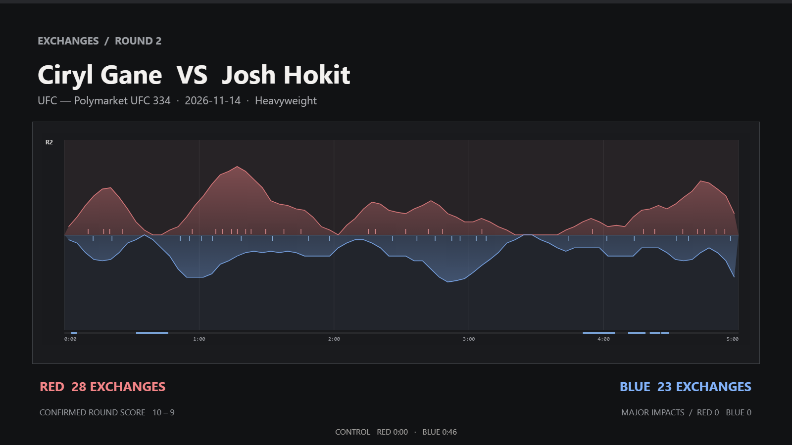
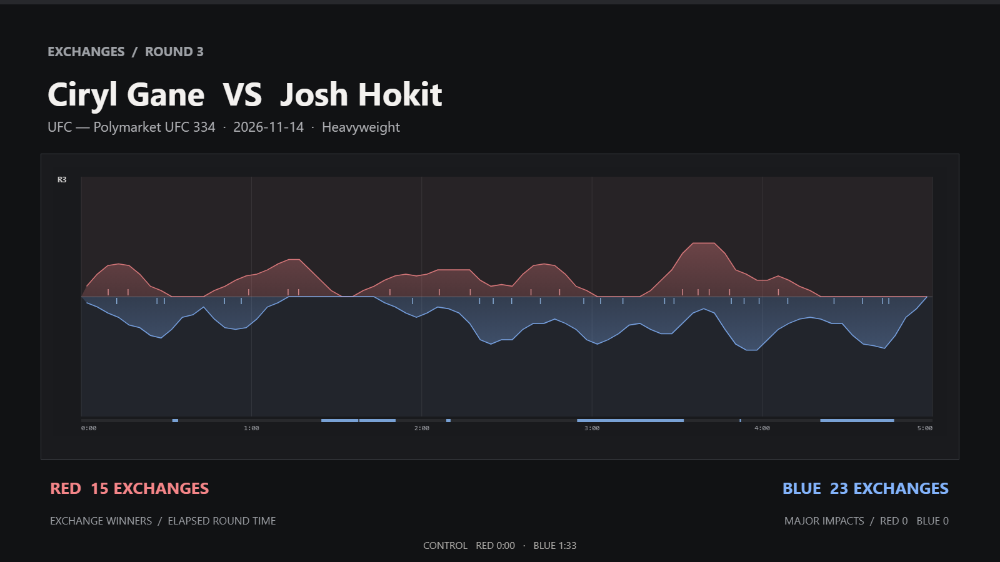
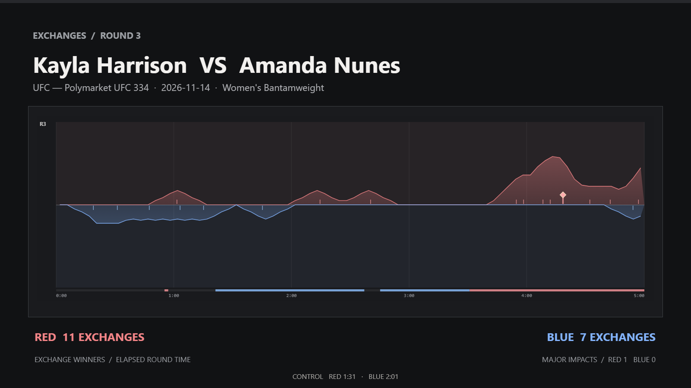
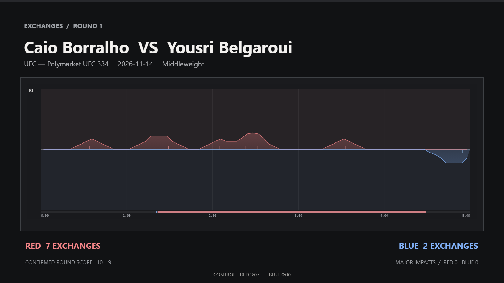
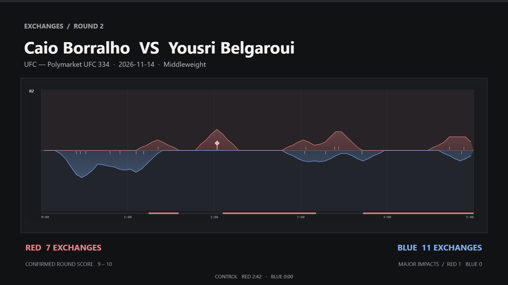
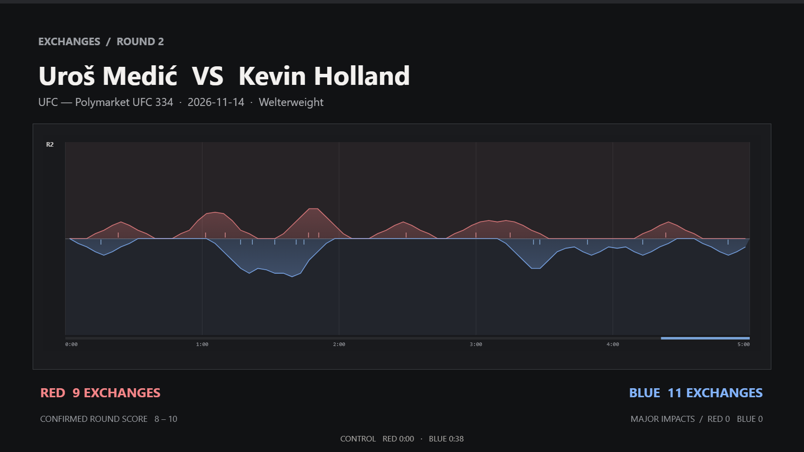
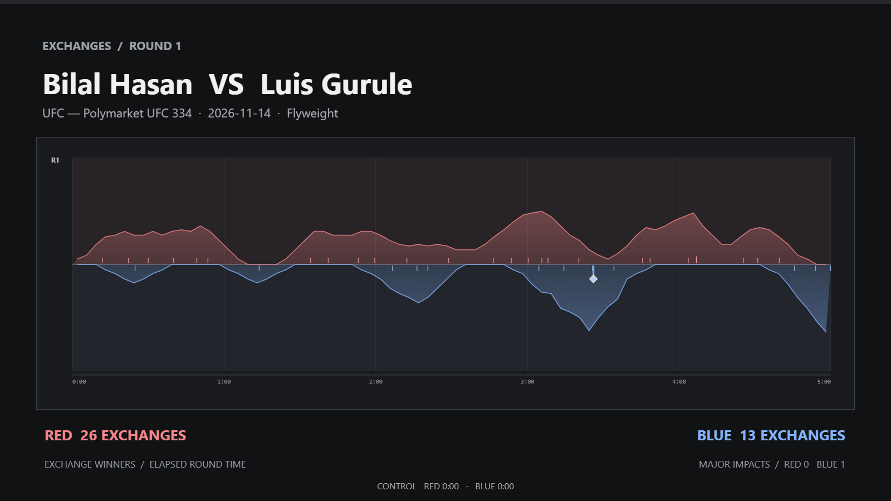
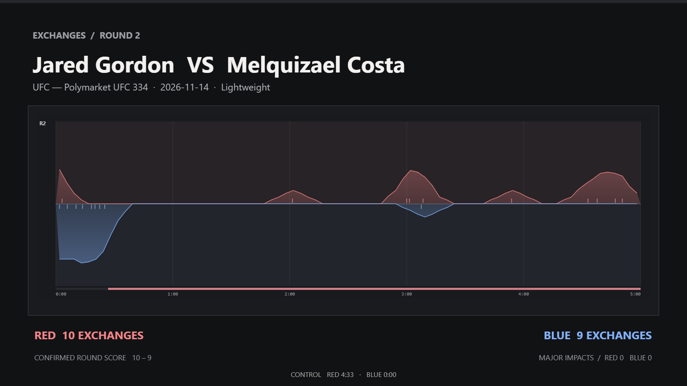
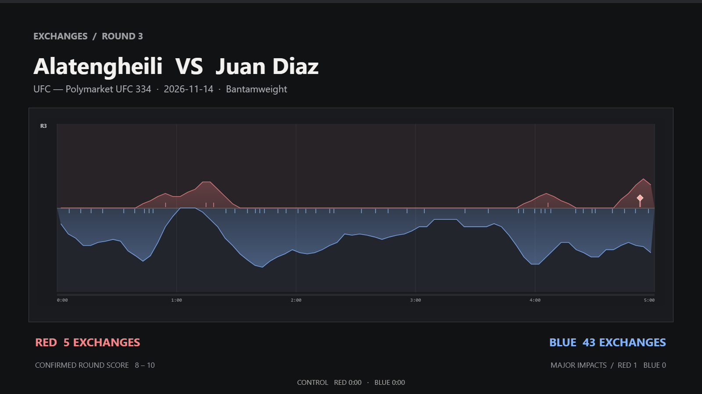
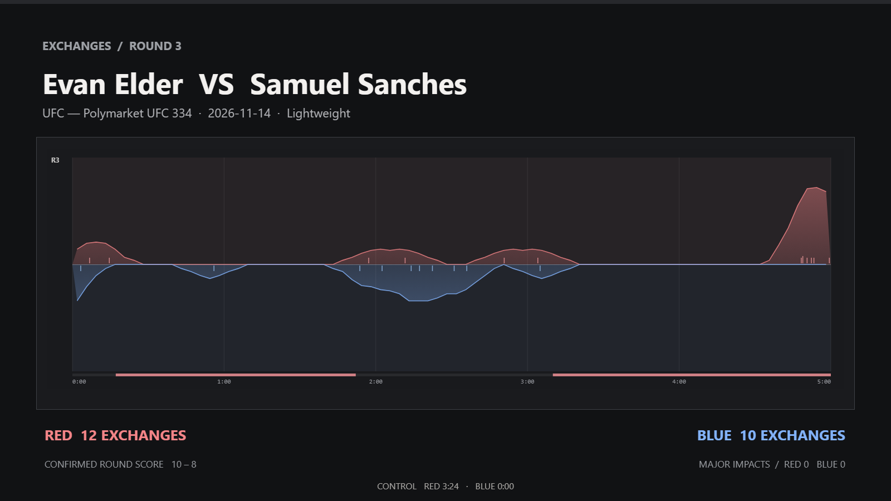

UFC 334 takes place November 14 at Madison Square Garden in New York City. Follow the results below as the card unfolds. I'll add my scoring and brief fight notes throughout the night.

## Main card

### Ciryl Gane vs. Josh Hokit (Ciryl Gane wins via unanimous decision)

Round 1:
A ferocious pace set by Hokit who charges across the octagon for a takedown. Gane gets back up and the majority of this round is Gane circling and jabbing, throwing the occasional uppercut as Hokit relentlessly charges forward with his head on the centerline. Hokit does get some clean shots in there and DC, Rogan are screaming their brains out whenever he does. Hokit lifts Gane above his head and slams him to the ground near the end of the round. 10-9 Gane.
It should be noted Gane did get an eye poke in there as he tried to frame off Hokit's face and create separation. 

<figure class="article-inline-image article-inline-image--break article-inline-image--center" data-writer-media-id="media-10653a5a" data-media-flow="break" data-media-align="center" data-media-width="100" style="--media-width:100%;">
  
</figure>

Round 2: More of the same in this round as Hokit recklessly closes distance and Gane making Hokit pay for it with knees and jabs. They both spend quite a bit of time in the clinch, both hanging onto the single collar though Josh isn't really doing much damage from here. A couple heavier blows landed from Hokit and DC and Rogan again explode like they rocked Gane but I don't think it did. The punch lands clean for sure by the time it actually reaches Gane the punch appears to have lost a lot of its momentum and pop. Quite a few failed takedowns as Gane sprawled on Hokit, too. Certainly a closer round but pretty clear to me Gane landed more. 10-9 Gane

<figure class="article-inline-image article-inline-image--break article-inline-image--center" data-writer-media-id="media-542989ab" data-media-flow="break" data-media-align="center" data-media-width="100" style="--media-width:100%;">
  
</figure>

Round 3: This is by far Hokit's best round as Gane is looking completely gassed. To be fair, they both look pretty tired but Hokit is moving forward and Gane is stepping back. The majority of this round takes place in the clinch with Hokit's most effective and clean landing shot is an elbow to the dome. It is almost exclusively the only strike he lands aside from foot stomps against the cage. Gane still landing jabs and crosses here and there but Hokit fought a good round eliminating the distance game as best he could. 10-9 Hokit.

<figure class="article-inline-image article-inline-image--break article-inline-image--center" data-writer-media-id="media-ee380a6c" data-media-flow="break" data-media-align="center" data-media-width="100" style="--media-width:100%;">
  
</figure>

Round 4: Almost a repeat of round 3 as a majority of the fight takes place in a 50/50 position in the clinch, however, Gane found way more opportunities to land strikes this time around. Gane at range landed better shots and he also did in the clinch. Hokit spent much more time leaning on Gane and throwing foot stomps. Hokit's punches in the clinch almost don't even count as strikes as they are so ineffective and labored. Gane's are too but at least he's landing knees. Close round and I think some may see this round for Hokit just because of optics but I think its a pretty clear round for Gane. He landed in more volume at range and in the clinch so I don't think the aggression aspect or the control time come into play for Hokit. 10-9 Gane

<figure class="article-inline-image article-inline-image--break article-inline-image--center" data-writer-media-id="media-be58deed" data-media-flow="break" data-media-align="center" data-media-width="100" style="--media-width:100%;">
  
</figure>

Round 5: Hokit charges across the octagon for a takedown attempt which is thwarted by Gane. He tries for another, again failed. Gane making him pay with shots in between. They spend more time in the clinch again to which Gane is landing the better shots. Hokit landed a couple of shots. I cannot overstate how ridiculously enthusiastic Rogan and DC are every time Hokit lands one clean punch. I understand the crowd cheering but if you had a blindfold on, you'd think Hokit was beating the shit out of Gane. It's quite the opposite in reality. Hokit has nothing for Gane in round 5. 10-9 Gane

<figure class="article-inline-image article-inline-image--break article-inline-image--center" data-writer-media-id="media-a68b5268" data-media-flow="break" data-media-align="center" data-media-width="100" style="--media-width:100%;">
  
</figure>

An incredibly sloppy fight that essentially looked like Gane, despite being gassed, outclassing Hokit in every facet of MMA. Gane could've benefited from a more dynamic game in the clinch and he certainly did not throw anywhere near the amount of kicks that he usually does. I think not kicking Hokit was Gane's biggest misstep in this fight. Sure, he may have been more vulnerable to takedowns or allowing Hokit to close distance but the pros would've heavily and easily outweighed the cons. The one kick to the leg I remember him throwing moved Hokit's entire body. Had he kept that up, Hokit barely would've been standing by round 5 as Hokit is always charging forward. This fight is further proof that heavyweight is in shambles. 

<figure class="article-inline-video article-inline-video--break article-inline-video--center" data-writer-media-id="media-e68272dd" data-media-flow="break" data-media-align="center" data-media-width="100" style="--media-width:100%;">
  

    <video loop muted playsinline preload="none" src="https://github.com/MatlockFT/Matlock/releases/download/writer-media-2026-11/ufc-334-live-results-scoring-video-20261115-175432-670.mp4" aria-label="Article video"></video>
  

</figure>

My card: 49-46 Gane and that is the only acceptable answer. 

---

### Kayla Harrison vs. Amanda Nunes (Kayla Harrison wins via submission round 4 - rear naked choke)

Round 1: Both meet in center and play the distance game which is tremendously bad idea for Harrison. Nunes launching shots from very far out of range but she's getting closer. She lands a few and  Harrison is getting desperate for these takedowns to which Amanda is defending well. Eventually, Kayla does get a throw, traps her in a headlock and an arm trapped, free to punch Nunes face which she does. Not much heat in these punches however and no visible damage despite being in such a dominate position. This was much needed for Kayla Harrison as she was surely losing the fight up to that point. 10-9 Harrison

<figure class="article-inline-image article-inline-image--break article-inline-image--center" data-writer-media-id="media-5d26573c" data-media-flow="break" data-media-align="center" data-media-width="100" style="--media-width:100%;">
  
</figure>

Round 2: Harrison gets pieced up at range again but Kayla ties her up. They spend a significant amount of time against the cage with Amanda holding her there and even getting a takedown. Eventually, Kayla does another throw, an impressive one where Nunes lands hard on the mat. Harrison eventually secures crucifix once again and landing elbows. She maintains this position for the rest of the round. 10-9 Harrison

<figure class="article-inline-image article-inline-image--break article-inline-image--center" data-writer-media-id="media-aeeab4a9" data-media-flow="break" data-media-align="center" data-media-width="100" style="--media-width:100%;">
  
</figure>

Round 3: At range, Nunes lands a couple shots, then end up on the cage, with Amanda holding position but I think Kayla might be hanging onto her neck, they stay here for awhile, Amanda gets another takedown. Amanda actually gets the back, threatens with the RNC but she eventually gets reversed and Kayla is on top. Kayla lands a sharp elbow that cuts Amanda and ends the round with ground and pound. 10-9 Harrison

<figure class="article-inline-image article-inline-image--break article-inline-image--center" data-writer-media-id="media-f544b1a7" data-media-flow="break" data-media-align="center" data-media-width="100" style="--media-width:100%;">
  
</figure>

Round 4: Nunes looks gassed. Legs look heavy as she is not even nearly as light and agile with her footwork. She still threw a couple bombs though which Kayla takes on the chin. She tries to tie her up but to no avail. Nunes throws a front kick to the body and Kayla catches it, Nunes loses her balances and falls, crawling on her hands and knees as Kayla sprints forward, takes the back, secures a choke and Amanda taps. Fight over. 

An incredibly curious game plan from Amanda who was more than happy to wrestle and grapple with Kayla Harrison which is quite baffling. The few times Nunes did throw, she landed. But overall, she looked slow and looked even worse in the 4th when she gassed out.

This fight, despite some of the struggles on the feet, is the best Kayla Harrison has looked. Her judo really came into play here and she had some of the best throws of her career. Her judo has always worked in MMA but never had that highlight reel level of trips and throws in the UFC like Ronda did. This fight she had a couple and they were critical to her success in this fight. Amanda had her moments, too but they ultimately ended with her not being in dominate position and subsequently gassed her out. 

---

### Caio Borralho vs. Yousri Belgaroui

Round 1: At range, Caio is throwing very long jabs to the body, getting out of range while Belgaroui is throwing kicks that are completely out of range. Caio gets it to the ground and establishes significant control time and landing a couple shots on the ground. Back to the feet, Belgaroui doesn't have long to work but throws a heavy head kick. Blocked by Caio but it might've stung him a bit. Belgaroui pressures and lands a couple more punches. Too little, too late. 10-9 Caio Borralho

<figure class="article-inline-image article-inline-image--break article-inline-image--center" data-writer-media-id="media-c8850b6c" data-media-flow="break" data-media-align="center" data-media-width="100" style="--media-width:100%;">
  
</figure>

Round 2: Caio doing little at the start of this round, just getting kicked and letting Belgaroui establish his game. Caio does land one good check left hook it looks like, which got Belgaroui backing up for a second, Caio closes distance and starts grappling. Some control time before they're back at range where Belgaroui is back to landing some shots but again, Caio finds some success of his own in striking. More control time for Caio up until the end. Actually a close round and as far as optics, I could see giving it to Borralho but can't forget how the round started. 10-9 Belgaroui

<figure class="article-inline-image article-inline-image--break article-inline-image--center" data-writer-media-id="media-599f128b" data-media-flow="break" data-media-align="center" data-media-width="100" style="--media-width:100%;">
  
</figure>
Round 3: Belgaroui doing good at range, landing his shots, Caio has some responses but not much so he tries for a takedown. Gets it. Not much done on the ground as Belgaroui works back to the feet. Belgaroui landing his shots again and a big knee that has Caio backing up. Caio lands a heavy counter as Belgaroui was about to put the pressure on. They're both good tho, couple more shots land for Belgaroui and he is taken down again. Not much done with it, Belgaroui back to his feet, Borralho keeping him against the cage and landing a couple of knees to the legs. This seems to be a clear round for Belgaroui. 10-9 Belgaroui

<figure class="article-inline-image article-inline-image--break article-inline-image--center" data-writer-media-id="media-c1496128" data-media-flow="break" data-media-align="center" data-media-width="100" style="--media-width:100%;">
  
</figure>

My card: 29-28 Belgaroui
Judges: 30-27 x3 Caio Borralho

Not too surprised by the judges scorecards as Caio had Belgaroui on the back foot often and having to work back to his feet though I didn't see much for threatening offense. Belgaroui had the head kicks and knees to the body whenever Caio closed for a takedown. That, to me, isn't indicative of offense that prevents meaningful counters. Immediate damage is priority over cumulative damage but it's damage nonetheless. I think if I spend less time focusing on the x's and o's and just ask who it felt like had the more effective offense as a whole, Caio Borralho would come to mind. Though, the statistics do back my live scoring where I felt Belgaroui had the more meaningful striking offense on the feet. Though I disagree with the cards, I understand the perspective. 
--

### Uroš Medić vs. Kevin Holland (Draw)

Round 1: Kevin Holland is fighting very long. Mostly implementing a kicking game and keeping Medic at range. Medic having a hell of a time trying to find Holland and get through this reach. Medic tries to throw but gets countered with several uppercuts from Holland that drop Medic, sorta looked off balance to be fair but Holland tries to tie up a D'Arce (maybe an anaconda - I'm unsure). Medic survives though it looked grim for a bit. 10-9 Holland. 

<figure class="article-inline-image article-inline-image--break article-inline-image--center" data-writer-media-id="media-d337dfcb" data-media-flow="break" data-media-align="center" data-media-width="100" style="--media-width:100%;">
  
</figure>

Round 2: Both at range kicking again, Medic crashing in at times to land shots which is sort of working but not near enough because the volume just isn't there. Medic lands two low blows, the second of which Holland milks the full 5 minutes. Marc Goddard takes point from Medic. It's a razor close round this far. Back to Holland kicking which are kind of ineffective but they are the only thing happening. Holland tries for a takedown but Medic is back up, they end the round with Medic's back to the fence and Holland holding him there trying to land shoulder strikes. Close round but its a 10-9 for Holland, actually a 10-8 with the point deduction.

<figure class="article-inline-image article-inline-image--break article-inline-image--center" data-writer-media-id="media-b80f64b3" data-media-flow="break" data-media-align="center" data-media-width="100" style="--media-width:100%;">
  
</figure>
Round 3: Kevin continues keeping Medic at range with front leg side kicks targeting Medic's body and leg. He is exclusively winning this fight on those strikes specifically. Everything else Holland attempts is embarrassingly bad as he keeps losing his footing. Medic found a couple opportunities to land heavy shots, one a head kick and other just hooks. Medic's best round by far. Strange fight. 10-9 Medic

My card: 29-27 Holland
Judges get it wrong with this one: 28-28; 29-27 (Medic); 28-28 which are some insane scores. I understand Holland didn't exactly look like a world beater when he exclusively used front leg side kicks that landed with little impact but it was all the fight could really be scored on in the first two rounds. Not to mention Holland held Medic in a submission for about 2 minutes in the first round. David Bruce's card is a head scratcher. 

<figure class="article-inline-image article-inline-image--break article-inline-image--center" data-writer-media-id="media-a350b4a4" data-media-flow="break" data-media-align="center" data-media-width="100" style="--media-width:100%;">
  
</figure>

---

### Bilal Hasan vs. Luis Gurule  (Luis Gurule wins via split decision)

Round 1: Bilal Hasan comes out doing what he does constantly attacking with kicks and punches and staying mobile. Laser focused is Gurule, slowly marching forward through the onslaught, not letting Hasan operate at range. So he's cutting off the cage and trying to land his punches but with not much success. He does land one clean shot as Hasan was moving backward that knocked him down but I think he was really off balance because was right back up to his feet. 10-9 Hasan.

<figure class="article-inline-image article-inline-image--break article-inline-image--center" data-writer-media-id="media-812b17cc" data-media-flow="break" data-media-align="center" data-media-width="100" style="--media-width:100%;">
  
</figure>

Round 2: Some more success from Bilal Hasan at range with Gurule doing minimal work on the feet. Gurule is inching forward and trying to land counters. He tries for a couple takedowns that fail and he is catching kicks now. He does eventually get a takedown and lands a good elbow. This is a close round and one could argue the most damaging blow came from Gurule on the mat. 10-9 Hasan

<figure class="article-inline-image article-inline-image--break article-inline-image--center" data-writer-media-id="media-7654f432" data-media-flow="break" data-media-align="center" data-media-width="100" style="--media-width:100%;">
  
</figure>

Round 3: Hasan comes out fast, landing good shots. I think Hasan cut Gurule as they were headed to the mat. Gurule holds dominate top position with pitter patter ground and pound. 10-9 Gurule 

<figure class="article-inline-image article-inline-image--break article-inline-image--center" data-writer-media-id="media-08b3611e" data-media-flow="break" data-media-align="center" data-media-width="100" style="--media-width:100%;">
  
</figure>

My card 29-28 Hasan.
29-28 Hasan; 29-28 Gurule; 29-28 Luis Gurule

---

## Prelims

### Stephen Thompson vs. Charles Radtke (Stephen Thompson wins via round 3 TKO)

Story of this fight is Thompson loses first round most likely as Radtke closes distance to keep Thompson down. Thompson landed good shots throughout the fight and as Radtke gassed out, Thompson started beating the shit out of him until a hook kick ( I think) knocks down Radtke. Good.

---

### Drew Dober vs. Chris Duncan (Chris Duncan wins via unanimous decision 30-27x2, 29-28)

Round 1: Heavy exchanges but Duncan getting the best of Dober with the open stance matchup, especially with these kicks. Duncan lands a laser beam pull counter that gets Dober's knees to give way. He keeps standing however. Great round for Duncan who may have broken his foot. 10-9 Duncan

Round 2: Pure kickboxing round with Duncan having more volume, more impact, and the better exchanges. Dober with some good hits but he took the round off. 10-9 Duncan

Round 3: Pace has slowed substantially. They're both bombing in exchanges and this is Dober's best round thus far. He rocks Duncan but Duncan does recover, gets it to the ground. Through pure volume and pace, and a takedown with control and elbows, Duncan wins this round on my cards, too. 10-9 Duncan.

My score: 30-27 Duncan

---

### Jim Miller vs. Terrance McKinney (Terrance McKinney wins via first round knockout 1:53) (straight Left + ground and pound)

Round 1: Of course, I want Miller to win this fight but the fight game has no feelings and the pick is McKinney. Jab working for McKinney and it's fucking up Miller, cut open on the eye. Good counter from Miller lands. McKinney staying in his face. He just dropped Miller, following up, fight over.

---

### Donte Johnson vs. Cesar Almeida (Cesar Almeida wins via TKO round 1)

Round 1: Donte Johnson comes out aggressive. Almeida very reserved and reading. Wow, Johnson looking very sloppy right now and his footwork is pretty bad. He's a bit nervous, I think. Almeida with a sharp right hand. Fans and judges are gonna fuck this fight because Johnson is throwing a whole lot and nothing is landing whereas Almeida is sharp and quiet with his counters. Donte just threw a superman punch with his chin in the air, he's gonna get domed. Yep. Donte dropped and is trying to survive. He's back to his feet and throwing leather with Almeida, terrible idea. Donte dropped again. Ref stops it. 

---

## Early prelims

### Jared Gordon vs. Melquizael Costa (Melquizael Costa wins via unanimous decisions 29-28 x3)

Round 1: Gordon came out looking confident but Costa sticking and moving and landing these POWERFUL head kick that are rendering Gordon completely defensive. He is struggling to close the gap. He pushes Costa against the cage at the end but they separate and Costa lands a turning side kick to the body that launches Gordon to the ground. 10-9 Costa

<figure class="article-inline-image article-inline-image--break article-inline-image--center" data-writer-media-id="media-21f8e02c" data-media-flow="break" data-media-align="center" data-media-width="100" style="--media-width:100%;">
  
</figure>

Round 2: Gordon comes out fast, trying to close distance but Costa is hammering him moving backward, inside body kick lands, that was nasty. Gordon gets the takedown, stuck in a triangle but escapes. He takes Costa back, this is huge for him. Trying to sink in choke, he's got the hooks in - my bad, one hook in, he abandons it for punches, Costa moves, Gordon tries for back gain and Costa stands up, Gordon abandons the backpack. Gordon now working him against the cage, landing shots. Costa trip takedown, back to the cage, back to the mat. Savvy moves from Gordon who is showing his experience. He ends the Round on top landing shots. We got a fight! 10-9 Gordon. 

<figure class="article-inline-image article-inline-image--break article-inline-image--center" data-writer-media-id="media-ee854acf" data-media-flow="break" data-media-align="center" data-media-width="100" style="--media-width:100%;">
  
</figure>

Round 3: Gordon eats shots going in, but wrestles, gets Costa down. Gets back up and they're fighting at range. Gordon eating a lot of shots and they both are exhausted. Gordon failing some wrestling here. Gets him down near the end and Costa smartly ends the round going for a submission. That's a 10-9 Costa on my card but its going to be close. It comes down to how the judges score round 3.

<figure class="article-inline-image article-inline-image--break article-inline-image--center" data-writer-media-id="media-c5fa6c46" data-media-flow="break" data-media-align="center" data-media-width="100" style="--media-width:100%;">
  
</figure>

My card 29-28 Costa.

---

### Macy Chiasson vs. Bia Mesquita (Bia Mesquita wins via Submission (rear naked choke) in Round 1 (3:23)

Round 1: Chiasson circling on the outside, using good footwork and effective use of the dart. However, punches are paper and Mesquita with some power in her hands. They traded shots and Mesquita clearly landed the heavier shot. She got a body lock, slammed Chiasson to the mat, powerful elbows and punches on the ground, Chiasson trying to escape, gives up back, rear naked choke, tap. Very impressive victory for Bia Mesquita. 

---

### Alatengheili vs. Juan Diaz (Juan Diaz wins via unanimous decision 30-27 x3)

Round 1: Alategheili could not find his range, most shots missed the mark. His takedowns weren't coming either. Juan Diaz essentially out boxes him to a 10-9 round. 10-9 Diaz

<figure class="article-inline-image article-inline-image--break article-inline-image--center" data-writer-media-id="media-e9c19a3d" data-media-flow="break" data-media-align="center" data-media-width="100" style="--media-width:100%;">
  
</figure>

Round 2: Alategheili has absolutely nothing for Diaz. No adjustments except for maybe a jab at the very end but Diaz outboxed this dude completely and kept the fight where he wanted. No rocking Alategheili or significant damage but Alatengheili effectively had nothing. 10-8 Diaz.

<figure class="article-inline-image article-inline-image--break article-inline-image--center" data-writer-media-id="media-8d033a16" data-media-flow="break" data-media-align="center" data-media-width="100" style="--media-width:100%;">
  
</figure>

Round 3: More of exactly the same of Diaz out striking and outboxing Alategheili. Alategheili landed one good shot near the end of the fight that seemed to rock Diaz momentarily but its way too little, way too late. 10-8 Diaz.

<figure class="article-inline-image article-inline-image--break article-inline-image--center" data-writer-media-id="media-89a78f63" data-media-flow="break" data-media-align="center" data-media-width="100" style="--media-width:100%;">
  
</figure>

My card: 30-25 Juan Diaz

---

### Evan Elder vs. Samuel Sanches (Evan Elder wins via unanimous decision 30-26 x3)

Round 1: Both trade jabs. Elder now closing and throwing bombs, left hook lands and rocks Sanches. Elder gets it to the ground. Back up, now separated, Elder looks tired.  Elder drops Sancehes at end of round. 10-9 Elder

<figure class="article-inline-image article-inline-image--break article-inline-image--center" data-writer-media-id="media-1ffb3bbe" data-media-flow="break" data-media-align="center" data-media-width="100" style="--media-width:100%;">
  
</figure>

Round 2: Elder gets dropped with jab, more off balance I think but still solid. Story of this fight is Elder is landing in more volume and power but gets picked apart in between sprints. Takedown for Elder to close the round. 20-18 Elder

<figure class="article-inline-image article-inline-image--break article-inline-image--center" data-writer-media-id="media-f961e334" data-media-flow="break" data-media-align="center" data-media-width="100" style="--media-width:100%;">
  
</figure>

Round 3: They trade jabs and Elder tries for takedown. Cut opened I think on top Elder's head. Sanches back to the feet but Elder is not letting go of this body lock and he pushes him across the octagon back to the fence. Elder is crashing into the clinch over and over. He's exhausted. Sanches is picking him apart at range but Elder gets taken down. In round 1, Sanches grabbed the fence and he just did it again when getting taken down. Ref takes point. They're slugging it out in the center of the octagon. Elder getting the better and another takeodwn. 

<figure class="article-inline-image article-inline-image--break article-inline-image--center" data-writer-media-id="media-e375e5a4" data-media-flow="break" data-media-align="center" data-media-width="100" style="--media-width:100%;">
  
</figure>

My card: Evan Elder 30-26

---

[Full-card breakdown and predictions](/2026/11/08/ufc-334-gane-vs-hokit.html)
