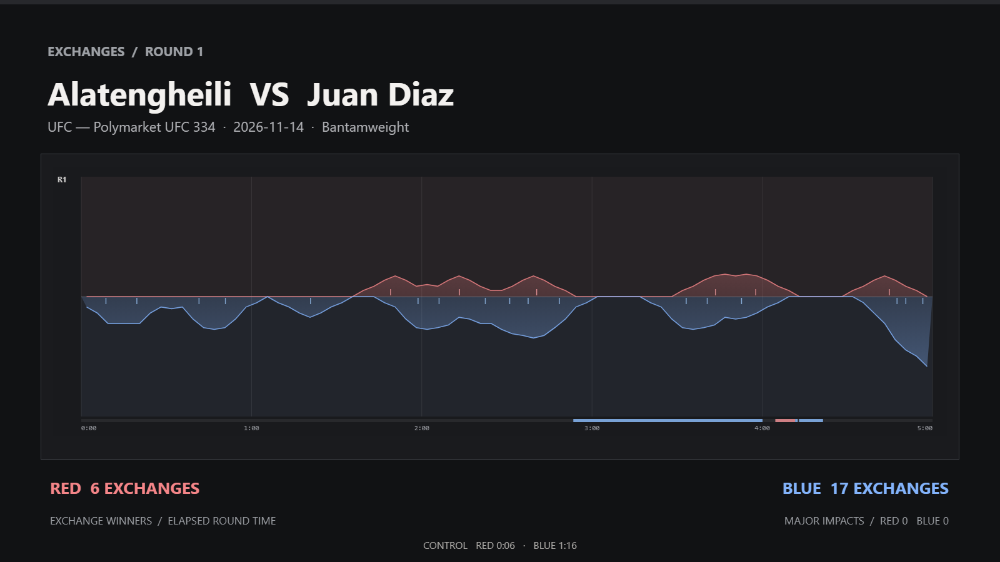
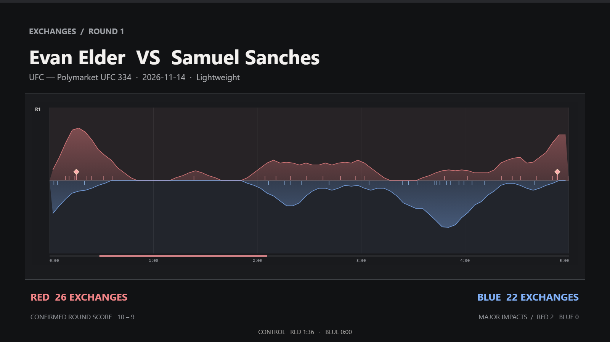

UFC 334 takes place November 14 at Madison Square Garden in New York City. Follow the results below as the card unfolds. I'll add my scoring and brief fight notes throughout the night.

## Main card

### Ciryl Gane vs. Josh Hokit

Round 1:

---

### Kayla Harrison vs. Amanda Nunes

Round 1:

---

### Caio Borralho vs. Yousri Belgaroui

Round 1:

---

### Uroš Medić vs. Kevin Holland

Round 1:

---

### Bilal Hasan vs. Luis Gurule

Round 1:

---

## Prelims

### Stephen Thompson vs. Charles Radtke

Round 1:

---

### Drew Dober vs. Chris Duncan

Round 1:

---

### Jim Miller vs. Terrance McKinney

Round 1:

---

### Donte Johnson vs. Cesar Almeida

Round 1:

---

## Early prelims

### Jared Gordon vs. Melquizael Costa

Round 1:

---

### Macy Chiasson vs. Bia Mesquita (Bia Mesquita wins via Submission (rear naked choke) in Round 1 (3:23)

Round 1: Chiasson circling on the outside, using good footwork and effective use of the dart. However, punches are paper and Mesquita with some power in her hands. They traded shots and Mesquita clearly landed the heavier shot. She got a body lock, slammed Chiasson to the mat, powerful elbows and punches on the ground, Chiasson trying to escape, gives up back, rear naked choke, tap. Very impressive victory for Bia Mesquita. 

---

### Alatengheili vs. Juan Diaz (Juan Diaz wins via unanimous decision 30-27 x3)

Round 1: Alategheili could not find his range, most shots missed the mark. His takedowns weren't coming either. Juan Diaz essentially out boxes him to a 10-9 round. 10-9 Diaz

<figure class="article-inline-image article-inline-image--break article-inline-image--center" data-writer-media-id="media-e9c19a3d" data-media-flow="break" data-media-align="center" data-media-width="100" style="--media-width:100%;">
  
</figure>

Round 2: Alategheili has absolutely nothing for Diaz. No adjustments except for maybe a jab at the very end but Diaz outboxed this dude completely and kept the fight where he wanted. No rocking Alategheili or significant damage but Alatengheili effectively had nothing. 10-8 Diaz.

<figure class="article-inline-image article-inline-image--break article-inline-image--center" data-writer-media-id="media-8d033a16" data-media-flow="break" data-media-align="center" data-media-width="100" style="--media-width:100%;">
  
</figure>

Round 3: More of exactly the same of Diaz out striking and outboxing Alategheili. Alategheili landed one good shot near the end of the fight that seemed to rock Diaz momentarily but its way too little, way too late. 10-8 Diaz.

<figure class="article-inline-image article-inline-image--break article-inline-image--center" data-writer-media-id="media-89a78f63" data-media-flow="break" data-media-align="center" data-media-width="100" style="--media-width:100%;">
  
</figure>

My card: 30-25 Juan Diaz

---

### Evan Elder vs. Samuel Sanches (Evan Elder wins via unanimous decision 30-26 x3)

Round 1: Both trade jabs. Elder now closing and throwing bombs, left hook lands and rocks Sanches. Elder gets it to the ground. Back up, now separated, Elder looks tired.  Elder drops Sancehes at end of round. 10-9 Elder

<figure class="article-inline-image article-inline-image--break article-inline-image--center" data-writer-media-id="media-1ffb3bbe" data-media-flow="break" data-media-align="center" data-media-width="100" style="--media-width:100%;">
  
</figure>

Round 2: Elder gets dropped with jab, more off balance I think but still solid. Story of this fight is Elder is landing in more volume and power but gets picked apart in between sprints. Takedown for Elder to close the round. 20-18 Elder

<figure class="article-inline-image article-inline-image--break article-inline-image--center" data-writer-media-id="media-f961e334" data-media-flow="break" data-media-align="center" data-media-width="100" style="--media-width:100%;">
  
</figure>

Round 3: They trade jabs and Elder tries for takedown. Cut opened I think on top Elder's head. Sanches back to the feet but Elder is not letting go of this body lock and he pushes him across the octagon back to the fence. Elder is crashing into the clinch over and over. He's exhausted. Sanches is picking him apart at range but Elder gets taken down. In round 1, Sanches grabbed the fence and he just did it again when getting taken down. Ref takes point. They're slugging it out in the center of the octagon. Elder getting the better and another takeodwn. 

<figure class="article-inline-image article-inline-image--break article-inline-image--center" data-writer-media-id="media-e375e5a4" data-media-flow="break" data-media-align="center" data-media-width="100" style="--media-width:100%;">
  
</figure>

My card: Evan Elder 30-26

---

[Full-card breakdown and predictions](/2026/11/08/ufc-334-gane-vs-hokit.html)
